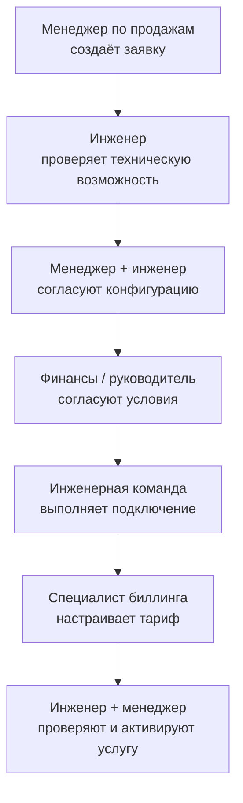
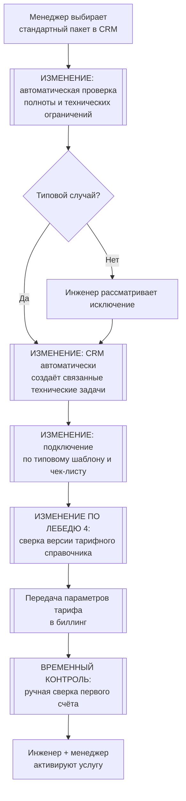
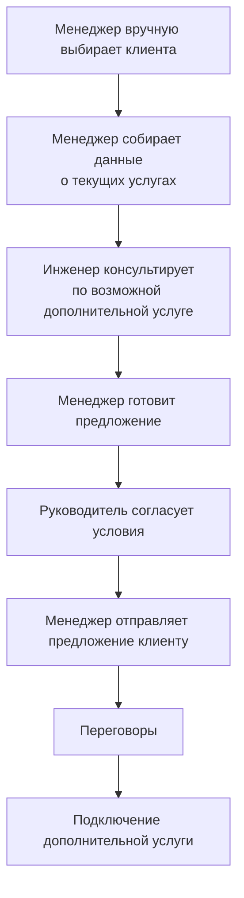
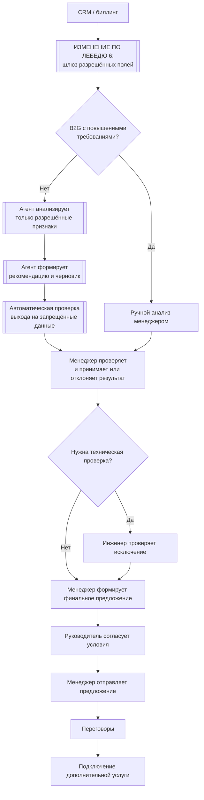

**Курс:** Управление информационными технологиями на предприятии

**Семестр:** осень/зима 2026

**Работа:** Практическая работа №3 — Процессы под гипотезы

**Студент:** Носова Арина Эдуардовна, ИСУ: 336516

> **Бизнес:** ООО «Наука-Связь», оператор связи и ИТ-интегратор.
>
> **Масштаб:** начиная с ПР2 периметр расчёта уточнён относительно ПР1. Для всех финансовых расчётов используется ООО «Наука-Связь» с выручкой **1,95 млрд руб. за 2025 год**. 1% выручки составляет **19,5 млн руб.** Данные группы используются как справочный контекст.
>
> **Направления:** телеком-услуги, ИТ-услуги и системная интеграция, строительство ВОЛС, промышленная автоматизация, производство электротехнической продукции.
>
> **ИТ-функция:** поставщик услуг, зона 🔴. Около 40% ИТ-вакансий длительно не закрываются, текучесть ИТ-персонала достигла 20%, поток запросов бизнеса вырос в 1,5 раза. Часть ИТ-специалистов участвует в оказании продаваемых клиентам услуг.
>
> **Ограничения:** внутренние данные о времени операций, загрузке сотрудников, стоимости труда и конверсии публично не раскрываются. Значения без фактического замера явно отмечены как допущения. Для каждого такого значения указан способ последующей проверки.

# Процессы под гипотезы

**Цель работы:** перепроектировать процессы, через которые реализуются принятые в ПР2 гипотезы, определить исходную точку, показать потери, описать изменения с опорой на ITIL 4 и DevOps и определить место агента в новом процессе.

В ПР2 в работу были взяты гипотезы:

- стандартизация и цифровизация подключения новых B2B-клиентов
- допродажи существующей клиентской базе
- удержание и переподготовка сотрудников как ресурсная гипотеза

Для ПР3 выбраны два процесса, которые напрямую влияют на выручку и используют один и тот же дефицитный инженерный ресурс:

- **процесс подключения нового типового B2B-клиента**, который реализует гипотезу «Стандартизация и цифровизация подключения»
- **процесс допродажи существующему B2B/B2G-клиенту**, который реализует гипотезу «Допродажи существующей клиентской базе»

Гипотеза про удержание и переподготовку сотрудников остаётся ресурсным условием для обоих процессов. Отдельный HR-процесс в ПР3 не моделируется, поскольку работа ограничена двумя процессами.

После выполнения исходной версии ПР3 произошли два новых события:

- **лебедь 4:** после автоматизации передачи тарифа из CRM в биллинг у каждого десятого нового клиента первый счёт формируется по неверной тарифной категории. Две из шести выкладок за квартал откатываются, Change Failure Rate превышает установленный предел 20%, восстановление занимает более 8 часов. Финансовая служба возвращает ручную сверку первого счёта
- **лебедь 6:** агент сформировал предложение для B2G-клиента с данными другого клиента, поскольку в контекст попало поле свободного комментария CRM. Дополнительно выяснилось, что подрядчик, внедрявший агента, имел доступ к CRM, хотя отсутствовал в перечне допущенных подрядчиков

Оба события встроены в процессы ниже. Они меняют ожидаемый эффект, набор ITIL-практик, DORA, границы агента и trade-off.

# Связь процессов с гипотезами ПР2

| Процесс | Гипотеза из ПР2 | Через какой шаг реализуется гипотеза |
|---|---|---|
| Подключение нового типового B2B-клиента | Стандартизация и цифровизация подключения | Проектирование, проверка технической возможности, постановка задач на подключение, передача параметров в биллинг и контроль первого счёта |
| Допродажа существующему клиенту | Допродажи существующей клиентской базе | Выбор клиента, анализ уже используемых услуг, формирование рекомендации, проверка предложения и подключение дополнительной услуги |

Для обоих процессов действует общий ресурсный приоритет из ПР2:

1. эксплуатация услуг, нарушение которых ведёт к потере действующей выручки или SLA
2. работы, связанные с привлечением и обслуживанием новых клиентов
3. обязательные работы по ИБ и регуляторным требованиям
4. автоматизация, снижающая расход дефицитного инженерного труда
5. остальные изменения

После лебедей приоритет уточняется:

- исправление ошибок тарифных справочников и контроль корректности первого счёта относятся к первой категории
- устранение утечки данных агента и проверка подрядчика относятся к третьей категории
- новые функциональные возможности CRM и агента временно уступают этим задачам по приоритету

# Процесс подключения нового типового B2B-клиента до изменения

Процесс начинается после согласования коммерческих условий и заканчивается началом биллинга по подключённой услуге.

Фактические внутренние данные компании недоступны. Поэтому временные значения ниже являются допущениями ПР3. Они нужны как предварительная исходная точка. До пилота значения должны быть заменены выгрузкой из CRM, Service Desk, системы технических заявок и биллинга за последние 3 месяца.

Для внешней проверки порядка величины используются открытые ориентиры операторов связи. МТС Бизнес указывает срок подключения интернета и телефонии для бизнеса **от 3 до 10 дней**, а билайн бизнес сообщает о подключении интернета для юридических лиц в среднем за **2–3 дня** при наличии технической возможности. Эти значения не считаются прямым нормативом для «Наука-Связи», поскольку набор услуг и сложность проектов различаются. Они показывают, что исходные 20 рабочих дней требуют проверки и могут указывать на значительную долю внутренних ожиданий.

Источники:

- [МТС Бизнес. Как подключить интернет или телефонию для бизнеса](https://support.mts.ru/mts_fiksirovannaya_svyaz/podklyuchenie-interneta-i-telefonii-dlya-biznesa/kak-podklyuchit-internet-ili-telefoniyu-dlya-biznesa)
- [билайн бизнес. Интернет для юридических лиц и ИП](https://moskva.beeline.ru/business/office-internet/internet-v-ofis/)

## Схема процесса до изменения

## Таблица потерь до изменения

| Шаг | Роль | Время работы | Время ожидания | В чём потеря | Источник замера |
|---|---|---:|---:|---|---|
| Создание и проверка заявки | Менеджер по продажам | 0,75 ч | 4 ч | повторный ввод параметров клиента, ожидание проверки полноты заявки | допущение, затем CRM за 3 месяца, владелец: руководитель продаж |
| Проверка технической возможности | Сетевой или проектный инженер | 2,5 ч | 24 ч | заявка ждёт свободного инженера, часть данных приходится уточнять | допущение, затем система технических заявок за 3 месяца, владелец: руководитель инженерного блока |
| Формирование технической конфигурации | Менеджер по продажам + инженер | 3 ч | 16 ч | индивидуальная проработка типовых случаев | допущение, затем CRM + Service Desk за 3 месяца |
| Внутреннее согласование | Руководитель направления / финансы | 1 ч | 16 ч | последовательное согласование | допущение, затем CRM или СЭД за 3 месяца |
| Подключение и настройка | Инженерная команда | 12 ч | 48 ч | ожидание очереди исполнения, ручная постановка отдельных задач | допущение, затем Service Desk / система технических работ за 3 месяца |
| Настройка биллинга | Специалист биллинга | 1,5 ч | 12 ч | повторный перенос параметров из заявки | допущение, затем биллинг + Service Desk за 3 месяца |
| Приёмка и активация | Инженер + менеджер | 3,25 ч | 16 ч | ожидание подтверждений и ручная сверка | допущение, затем Service Desk + CRM за 3 месяца |
| **Итого** |  | **24 ч** | **136 ч** |  |  |

Полное расчётное время цикла:

**24 ч работы + 136 ч ожидания = 160 ч = 20 рабочих дней**

Доля ожидания:

**136 / 160 × 100% = 85%**

Главная потеря находится во времени ожидания. Самые крупные участки:

- ожидание исполнения подключения: 48 ч
- ожидание технической проверки: 24 ч
- согласование конфигурации и внутренних условий: 32 ч суммарно

Трудоёмкость одного типового подключения составляет **24 человеко-часа**.

# Процесс подключения нового типового B2B-клиента после изменения

Изменения применяются только к типовым подключениям. По гипотезе ПР2 предполагается, что не менее 70% подключений целевого сегмента можно провести по стандартному маршруту.

Лебедь 4 показал, что автоматическая передача тарифных параметров без общего владельца справочника создаёт финансовую ошибку. Поэтому новый процесс дополнен управлением мастер-данными и временным контролем первого счёта.

## Схема процесса после изменения

## Изменения и связь с потерями

| Изменение | Какую потерю убирает | Гипотеза ПР2 | Ожидаемое время работы | Ожидаемое ожидание |
|---|---|---|---:|---:|
| Стандартный пакет и обязательные поля в CRM | повторный ввод данных и возврат неполной заявки | Стандартизация и цифровизация подключения | 0,5 ч | 1 ч |
| Автоматическая предварительная техническая проверка | очередь на инженера для типовых случаев | Стандартизация и цифровизация подключения | 1,5 ч в среднем с учётом исключений | 16 ч |
| Типовая конфигурация услуги | индивидуальное проектирование стандартного подключения | Стандартизация и цифровизация подключения | 1,5 ч | 8 ч |
| Упрощённое согласование типового пакета | последовательное согласование уже утверждённых условий | Стандартизация и цифровизация подключения | 0,5 ч | 8 ч |
| Автоматическое создание связанных задач | ручная передача между продажами и техническими подразделениями | Стандартизация и цифровизация подключения | включено в системную операцию | включено в системную операцию |
| Подключение по шаблону и чек-листу | повторная настройка типовых элементов | Стандартизация и цифровизация подключения | 10 ч | 40 ч |
| Единый владелец тарифного справочника и автоматическая сверка версий CRM / биллинга | расхождение тарифных категорий между системами | Стандартизация и цифровизация подключения + реакция на лебедя 4 | 0,25 ч | 1 ч |
| Ручная сверка первого счёта до стабилизации интеграции | риск выставления неверного первого счёта | реакция на лебедя 4 | 0,5 ч | 7 ч |
| Приёмка и активация | ручная сверка нескольких источников | Стандартизация и цифровизация подключения | 3 ч | 16 ч |
| **Итого после лебедя 4** |  |  | **18,25 ч** | **97 ч** |

Полное ожидаемое время после первоначальной автоматизации без лебедя составляло около 14 рабочих дней.

После возврата ручной сверки и добавления контроля справочников:

**18,25 ч работы + 97 ч ожидания = 115,25 ч = около 14,4 рабочего дня**

Таким образом, лебедь 4 съедает часть ожидаемой экономии. Процесс всё ещё быстрее исходных 20 дней, но эффект ниже первоначального.

Для устранения причины ошибки назначается единый бизнес-владелец тарифного справочника. В модели эту роль выполняет **коммерческий директор**, поскольку тарифная категория является частью коммерческого предложения. Владельцы CRM и биллинга становятся техническими хранителями справочника и не могут самостоятельно менять бизнес-значение тарифа.

До каждой выкладки выполняются:

- автоматическое сравнение версий справочников CRM и биллинга
- контрактный тест на соответствие пакет → тарифная категория
- тестовый расчёт первого счёта
- пилотная выкладка на ограниченной группе новых подключений
- автоматическая сверка первого счёта после активации

Ручная сверка 100% первых счетов сохраняется временно. Она снимается после двух последовательных выкладок, если:

- доля неверной тарифной категории ниже 1%
- не было отката из-за ошибок тарификации
- восстановление после ошибки укладывается в 8 часов

После выполнения этих условий остаётся выборочный ручной контроль 10% новых подключений.

# Расчёт эффекта процесса подключения

В исходной версии расчёт был привязан к условной ёмкости трёх инженеров. После обратной связи расчёт перестроен так, чтобы не подбирать число сотрудников под нужный эффект.

За базовую единицу берётся **1 FTE инженерного ресурса**, реально выделенного на типовые подключения.

Допущение о продуктивном времени:

- номинально 40 ч в неделю × 52 недели = 2080 ч в год
- 28 календарных дней отпуска дают около 20 рабочих дней, или 160 ч
- 10% времени резервируется на встречи, обучение и внутренние задачи
- итоговая расчётная производственная ёмкость округляется до **1700 ч в год**

Это значение остаётся допущением и проверяется по табелю и фактической загрузке инженерного блока.

До изменения:

**1700 / 24 = около 70 типовых подключений на 1 FTE в год**

После изменения с учётом лебедя 4:

**1700 / 18,25 = около 93 типовых подключений на 1 FTE в год**

Прирост мощности:

**93 − 70 = около 23 подключений на 1 FTE в год**

Средняя годовая выручка нового типового клиента в ПР2 была принята равной **195 тыс. руб.** Это допущение должно быть проверено по договорам.

Максимальный эффект на 1 FTE при наличии соответствующего спроса:

**23 × 195 тыс. руб. = 4,485 млн руб. в год**

Относительно выручки ООО:

**4,485 / 1950 × 100% = около 0,23%**

Эффект на 1 FTE находится у нижней границы отраслевого коридора **0,2–1%**.

Для достижения исходного порога гипотезы ПР2 в 11,7 млн руб. требуется:

**11,7 млн / 4,485 млн = около 2,6 FTE**

Следовательно, гипотеза может дать исходные 0,6% только в том случае, если на типовые подключения фактически задействовано не менее 2,6 FTE и существует спрос минимум на 60 дополнительных подключений в год.

Эти два условия теперь считаются обязательными для проверки, а не предполагаются автоматически.

Спрос на дополнительные подключения проверяется через CRM:

- количество потерянных или отложенных заявок за 12 месяцев
- количество заявок, ожидающих технического ресурса
- количество потенциальных клиентов, которым отказали по сроку
- фактическое число новых подключений в месяц

Пока эти данные не получены, финансовый эффект процесса фиксируется как диапазон:

**от 4,49 млн руб. на каждый реально выделенный 1 FTE до 11,7 млн руб. при наличии 2,6 FTE и подтверждённого спроса.**

Эффект считается только по фактически подключённым и начавшим оплачиваться клиентам.

# Trade-off процесса подключения

Стандартизация ускоряет типовые подключения, но ухудшает условия для нетиповых случаев и после лебедя 4 возвращает часть ручного контроля.

В модели предполагается, что:

- 70% подключений проходят по стандартному маршруту
- 30% попадают в маршрут исключений

Для исключений ожидаемый срок остаётся **22 рабочих дня** против исходных 20 дней, то есть примерно на **10% дольше**.

После лебедя 4 появляется ещё одно устойчивое ухудшение:

- до стабилизации интеграции финансовая служба вручную проверяет 100% первых счетов
- это добавляет около **0,5 человеко-часа работы и 7 часов ожидания** на каждое типовое подключение
- скорость типового процесса становится около 14,4 дня вместо первоначально ожидаемых 14 дней

Получается следующий trade-off:

> типовые подключения проходят быстрее исходного процесса, но компания временно сохраняет ручной финансовый контроль и отдельную очередь для нетиповых клиентов. Скорость выпуска изменений также ограничивается до стабилизации тарификации.

# Процесс допродажи существующему клиенту до изменения

Процесс начинается с выбора клиента менеджером и заканчивается подключением дополнительной услуги.

Сейчас допродажи зависят от инициативы конкретного менеджера. В ПР2 была выбрана гипотеза системного анализа клиентской базы через CRM.

Временные показатели ниже являются допущениями. До пилота они должны быть проверены на истории коммерческих предложений и заказов за 12 месяцев.

## Схема процесса до изменения

## Таблица потерь до изменения

| Шаг | Роль | Время работы | Время ожидания | В чём потеря | Источник замера |
|---|---|---:|---:|---|---|
| Выбор клиента | Менеджер по продажам | 0,5 ч | 16 ч | поиск вручную, клиент выбирается по опыту менеджера | допущение, затем CRM за 12 месяцев |
| Сбор данных об услугах | Менеджер по продажам | 0,75 ч | 8 ч | данные собираются из нескольких записей и систем | допущение, затем CRM + биллинг |
| Техническая консультация | Инженер | 1 ч | 16 ч | ожидание дефицитного инженерного ресурса | допущение, затем Service Desk |
| Подготовка предложения | Менеджер по продажам | 1,5 ч | 8 ч | повторяющаяся ручная работа с похожими предложениями | допущение, затем CRM / СЭД |
| Согласование условий | Руководитель продаж | 0,5 ч | 8 ч | последовательное согласование | допущение, затем CRM / СЭД |
| Отправка и ожидание ответа | Менеджер по продажам | 0,25 ч | 40 ч | ожидание клиента | допущение, затем CRM |
| Переговоры | Менеджер по продажам | 1,5 ч | 24 ч | несколько циклов уточнений | допущение, затем CRM |
| Подключение дополнительной услуги | Инженер / эксплуатация | 2 ч | 16 ч | очередь технических работ | допущение, затем Service Desk |
| **Итого** |  | **8 ч** | **136 ч** |  |  |

Полное расчётное время:

**8 ч работы + 136 ч ожидания = 144 ч = 18 рабочих дней**

Доля ожидания:

**136 / 144 × 100% = 94,4%**

Для оценки конверсии вводится исходное допущение:

> среди клиентов, которым менеджеры вручную предлагают дополнительную услугу, текущая конверсия в продажу составляет около **8%**.

Значение должно быть проверено по CRM за последние 12 месяцев.

# Процесс допродажи существующему клиенту после изменения

В процесс добавляется внутренний агент. После лебедя 6 его контур данных и права существенно ограничиваются.

Агент больше не получает доступ к карточке CRM целиком. Перед ним ставится отдельный слой подготовки данных, который формирует разрешённый набор структурированных полей.

Для B2G-клиентов с дополнительными требованиями к защите сведений агент временно не используется до завершения проверки ИБ. Допродажи таким клиентам продолжаются вручную, поэтому собственники не теряют канал продаж полностью.

## Схема процесса после изменения

## Изменения и связь с потерями

| Изменение | Какую потерю убирает | Гипотеза ПР2 | Ожидаемое время работы | Ожидаемое ожидание |
|---|---|---|---:|---:|
| Шлюз разрешённых структурированных полей | попадание в контекст свободного комментария, персональных и сетевых данных другого клиента | Допродажи + реакция на лебедя 6 | 0,05 ч | 0,1 ч |
| Агент выбирает клиентов по набору используемых услуг | ручной поиск и зависимость от памяти менеджера | Допродажи существующей клиентской базе | 0,1 ч | 0,1 ч |
| Агент формирует рекомендацию и черновик | повторяющаяся подготовка похожих предложений | Допродажи существующей клиентской базе | 0,05 ч | 0,1 ч |
| Автоматическая проверка результата | риск выдачи фамилии, адреса узла связи или данных другого клиента | Допродажи + реакция на лебедя 6 | 0,05 ч | 0,2 ч |
| Менеджер принимает результат агента | риск ошибочной или неуместной рекомендации | Допродажи существующей клиентской базе | 0,17 ч | 4 ч |
| Инженер проверяет только исключения | очередь инженерных консультаций по типовым услугам | Допродажи существующей клиентской базе | 0,4 ч в среднем | 8 ч |
| Шаблон коммерческого предложения | повторный набор структуры предложения | Допродажи существующей клиентской базе | 0,4 ч | 4 ч |
| Согласование условий | не меняется | Допродажи существующей клиентской базе | 0,5 ч | 8 ч |
| Отправка и ожидание ответа | не меняется | Допродажи существующей клиентской базе | 0,25 ч | 40 ч |
| Переговоры | не меняются | Допродажи существующей клиентской базе | 1,5 ч | 24 ч |
| Подключение дополнительной услуги | не меняется | Допродажи существующей клиентской базе | 2 ч | 16 ч |
| **Итого для агентского маршрута** |  |  | **около 5,1 ч** | **около 104,5 ч** |

Полное ожидаемое время агентского маршрута:

**около 109,6 ч = 13,7 рабочего дня**

В предыдущей редакции часть сокращения ожидания была не связана с конкретным изменением. Теперь согласование, ожидание ответа, переговоры и подключение возвращены к исходным значениям. Ускорение возникает только на тех шагах, которые действительно меняются.

Для B2G-клиентов с повышенными требованиями к защите сведений действует ручной маршрут. Его расчётное время остаётся около **18 рабочих дней** до завершения проверки ИБ.

# Место агента

## Какие шаги передаются агенту

Агент выполняет:

- анализ набора уже подключённых услуг
- сопоставление профиля клиента с каталогом разрешённых допродаж
- ранжирование возможных предложений
- формирование черновика обоснования
- формирование черновика коммерческого предложения

После лебедя 6 агент не получает неструктурированный комментарий CRM.

## Что агент видит и чем действует

Разрешённый набор:

- внутренний идентификатор организации
- отраслевой сегмент
- перечень действующих услуг в виде кодов
- тарифная категория
- агрегированные показатели использования услуг
- утверждённый каталог дополнительных услуг
- признаки технической совместимости без адресов узлов и конкретных параметров сети

Запрещённый набор:

- поле свободного комментария CRM
- фамилии, телефоны и email контактных лиц
- адреса узлов связи
- реквизиты договорённостей с другими клиентами
- содержимое обращений, если оно не прошло отдельную очистку
- любые данные другой организации

Права агента:

- чтение разрешённого представления данных
- создание черновика рекомендации
- создание черновика задачи в CRM

Агент не может:

- менять данные CRM
- отправлять письмо клиенту
- менять цену
- создавать счёт
- активировать услугу
- видеть исходную карточку клиента целиком

После лебедя 6 доступ подрядчика к CRM приостанавливается. Подрядчик может участвовать только после:

- включения в перечень допущенных поставщиков
- согласования ИБ
- фиксации состава доступных данных
- выдачи минимально необходимых прав
- регистрации и аудита действий

Рекомендация ограничивать доступ LLM к внешним источникам данных и очищать чувствительные сведения соответствует рекомендациям OWASP по Sensitive Information Disclosure. OWASP отдельно рекомендует ограничивать доступ модели к внешним данным и применять sanitization и строгий контроль доступа.

Источник: [OWASP GenAI Security Project, LLM02:2025 Sensitive Information Disclosure](https://genai.owasp.org/llmrisk/llm022025-sensitive-information-disclosure/)

## Кто принимает результат и сколько это стоит

Результат принимает **менеджер по работе с клиентом**.

Допущения:

- пилотная выборка 150 клиентов
- проверка одного результата занимает 10 минут
- полная стоимость часа менеджера принимается равной 1200 руб.
- вычислительная стоимость агента принимается равной 30 руб. на клиента
- 30% черновиков отклоняются менеджером
- для отклонённого черновика менеджеру требуется дополнительно 1,5 ч, чтобы подготовить предложение вручную

Стоимость проверки одного результата:

**10 / 60 × 1200 = 200 руб.**

Стоимость проверки всех 150 результатов:

**150 × 200 = 30 000 руб.**

Стоимость вычислений:

**150 × 30 = 4 500 руб.**

Отклонённые результаты:

**150 × 30% = 45 черновиков**

Стоимость ручной подготовки вместо отклонённого черновика:

**45 × 1,5 × 1200 = 81 000 руб.**

Полная стоимость агента, приёмки и ручной доработки:

**30 000 + 4 500 + 81 000 = 115 500 руб.**

До изменения ручной выбор клиента, сбор информации и подготовка предложения занимали:

**0,5 + 0,75 + 1,5 = 2,75 ч на клиента**

Для 150 клиентов:

**150 × 2,75 × 1200 = 495 000 руб.**

Расчётная экономия трудовых затрат на пилоте:

**495 000 − 115 500 = 379 500 руб.**

Цена приёмки и ручной доработки отклонённых результатов вычтена полностью.

## Что агенту не передаётся

Агенту не передаются:

- индивидуальная цена
- юридически значимое согласование
- решение о скидке
- отправка финального предложения
- изменение договора
- нестандартная техническая схема
- персональные данные контактных лиц
- адреса узлов и параметры сети
- свободные комментарии CRM

Для B2G-клиентов с повышенными требованиями к защите сведений действует ручной режим до отдельного допуска со стороны ИБ.

# Расчёт эффекта процесса допродаж

В предыдущей версии целевая конверсия выросла с 8% до 20% без достаточного обоснования.

После обратной связи и лебедя 6 этот показатель пересмотрен.

В качестве внешнего ориентира используются открытые кейсы телеком-компаний:

- Sprinklr сообщает о **8% улучшении sales conversion** при использовании рекомендаций в телеком-пилоте
- PGI-Data сообщает о **15% uplift in offer conversion** в телеком-кейсе Next Best Offer
- Agilytic сообщает о **10% увеличении conversion rate** при использовании рекомендаций для крупного оператора связи

Источники:

- [Sprinklr. Telecommunications provider transforms agent experience](https://www.sprinklr.com/stories/telecommunications-provider-transforms-agent-experience/)
- [PGI-Data. AI-Powered NBO/NBA for a Leading Brunei Telco](https://pgi-data.com/case-studies/brunei-telco-nbo-nba.html)
- [Agilytic. Next Best Offer case](https://www.agilytic.com/results/next-best-offer)

Эти кейсы используются только как ориентир. Они не доказывают эффект для ООО «Наука-Связь».

Для пилота принимается консервативный рост конверсии на **10% относительно исходной конверсии**.

Исходная конверсия:

**8%**

Целевая конверсия:

**8% × 1,10 = 8,8%**

Рост раскладывается следующим образом:

- около половины ожидаемого прироста связывается с более точным отбором клиентов по данным CRM и биллинга
- вторая половина связывается с тем, что менеджер быстрее получает готовый набор релевантных услуг и успевает обработать больше подходящих клиентов

Это разделение является допущением и проверяется A/B-пилотом:

- контрольная группа: ручной выбор клиентов
- тестовая группа: агентский подбор на разрешённых данных
- менеджеры обеих групп используют одинаковые коммерческие условия

Для пилота 150 клиентов:

До изменения:

**150 × 8% = 12 продаж**

После изменения:

**150 × 8,8% = 13,2 ожидаемой продажи**

Ожидаемый прирост:

**1,2 продажи**

При средней дополнительной годовой выручке 520 тыс. руб.:

**1,2 × 520 тыс. = 624 тыс. руб.**

После вычета затрат агента, приёмки и ручной доработки:

**624 тыс. − 115,5 тыс. = 508,5 тыс. руб.**

На пилоте эффект мал и используется для проверки гипотезы, а не как годовой эффект компании.

Для выхода хотя бы на нижнюю границу отраслевого коридора 0,2% требуется:

**1,95 млрд × 0,2% = 3,9 млн руб.**

При сохранении прироста конверсии 0,8 процентного пункта и среднего эффекта 520 тыс. руб. на продажу необходим масштаб около 1200 подходящих клиентов в год:

**1200 × (8,8% − 8%) × 520 тыс. = 4,992 млн руб. валового прироста**

Расходы на агента, приёмку и доработку для 1200 клиентов:

- приёмка: **1200 × 200 = 240 тыс. руб.**
- вычисления: **1200 × 30 = 36 тыс. руб.**
- ручная доработка 30% черновиков: **360 × 1,5 × 1200 = 648 тыс. руб.**
- всего: **924 тыс. руб.**

Чистый ожидаемый эффект:

**4,992 − 0,924 = 4,068 млн руб.**

Относительно выручки:

**4,068 / 1950 × 100% = около 0,21%**

После лебедя 6 гипотеза остаётся потенциально значимой, но только при масштабе около 1200 подходящих клиентов в год и после подтверждения безопасности нового контура данных.

# Trade-off процесса допродаж

После лебедя 6 trade-off стал жёстче.

Преимущества:

- менеджер тратит меньше времени на поиск клиента и подготовку черновика
- рекомендации формируются системно
- допродажи продолжаются, что важно в условиях потери крупного клиента

Ухудшения:

- B2G-клиенты с повышенными требованиями временно переводятся на ручной процесс
- агент перестаёт видеть часть неструктурированного контекста, поэтому качество рекомендаций может снизиться
- появляется обязательная проверка выхода на запрещённые данные
- 30% черновиков в модели требуют полной ручной подготовки

Для B2G-клиентов время процесса остаётся около **18 рабочих дней**, тогда как безопасный агентский маршрут для остальных клиентов составляет около **13,7 дня**.

Дополнительно компания принимает репутационный риск по уже произошедшему инциденту. Объём приостановленного расширения договора B2G-клиента неизвестен и вносится в реестр допущений как финансовая величина, которую должен определить коммерческий директор.

# Практики ITIL 4

После лебедей набор практик уточняется.

| Практика ITIL 4 | Почему попадает в работу | Что меняется |
|---|---|---|
| Service request management | подключение типовой услуги начинается с клиентского запроса | стандартная форма заявки, обязательные поля, типовой маршрут и автоматическая постановка задач |
| Service level management | меняется обещаемый срок подключения | отдельно контролируются типовой маршрут, маршрут исключений и временный ручной контроль первого счёта |
| Change enablement | лебедь 4 показал высокий Change Failure Rate и откаты | вводятся обязательная сверка тарифных справочников, тест первого счёта, пилотная выкладка и критерии снятия ручного контроля |
| Monitoring and event management | ошибки тарифа должны выявляться до клиента | добавляются автоматическая сверка справочников, контроль первого счёта и мониторинг ошибок интеграции |
| Incident management | после лебедя 4 есть реальные неудачные изменения, после лебедя 6 произошёл инцидент утечки данных | оба события регистрируются как инциденты, назначаются владельцы, фиксируется время восстановления и corrective actions |
| Information security management | агент раскрыл данные другого клиента | вводится белый список полей, исключение свободного текста, проверка выхода, отдельный режим для B2G и аудит прав |
| Supplier management | подрядчик агента имел доступ к CRM без допуска | доступ приостанавливается, подрядчик проходит аккредитацию, ИБ-проверку и получает минимальные права |

Problem management добавляется только в части лебедя 4, если анализ покажет повторяющуюся корневую причину ошибок тарифных справочников. Основная корневая причина уже определена как раздельное ведение справочника в CRM и биллинге, поэтому создаётся problem record до полного устранения расхождения.

# DORA

После лебедя 4 часть DORA-показателей больше не является допущением.

Google Cloud и DORA определяют Deployment Frequency и Lead Time как показатели скорости поставки, а Change Failure Rate и Failed Deployment Recovery Time как показатели стабильности. DORA рекомендует анализировать скорость и стабильность совместно, а не максимизировать только частоту релизов.

Источник: [DORA, 2024 State of DevOps Report](https://dora.dev/research/2024/dora-report/2024-dora-accelerate-state-of-devops-report.pdf)

| Показатель DORA | Текущее значение после лебедя 4 | Основание | Решение |
|---|---:|---|---|
| Deployment Frequency | **6 выкладок за квартал, около 2 в месяц** | сценарий лебедя 4 | частота сама по себе не повышается до устранения ошибки справочников |
| Lead Time for Changes | **10 календарных дней, допущение** | исходная модель ПР3, фактическое значение нужно снять из Git/CI | измерить медиану commit → production за квартал |
| Change Failure Rate | **2 из 6 = 33,3%** | сценарий лебедя 4 | показатель превышает ранее установленный предел 20% |
| Failed Deployment Recovery Time | **более 8 часов** | сценарий лебедя 4 | показатель превышает защитный предел 8 часов |

Разработка хочет выпускать чаще, финансовая служба хочет заморозить изменения до конца пикового квартала.

Принимается компромисс:

- функциональные изменения CRM → Mariann временно замораживаются
- исправления, связанные с неверной тарификацией, разрешаются через ускоренный change-процесс
- каждое исправление выкатывается сначала на ограниченную группу подключений
- перед расширением проверяются справочник, первый счёт и возможность отката
- после двух успешных выкладок подряд с ошибкой тарифа менее 1% снимается полный freeze
- дальнейшая частота релизов увеличивается только при Change Failure Rate не выше 20% и recovery time не выше 8 часов

Таким образом, в конфликте «выпускать чаще» и «заморозить всё» выбирается управляемое ограничение изменений с отдельным каналом для исправлений.

# Совокупный эффект двух процессов

После лебедей финансовая оценка становится консервативнее.

## Подключение

Эффект зависит от фактического числа FTE и спроса.

На 1 FTE:

**около 4,485 млн руб. потенциальной дополнительной выручки в год**

Для достижения исходного порога 11,7 млн руб. требуется минимум 2,6 FTE и подтверждённый спрос минимум на 60 дополнительных подключений.

Пока эти данные не подтверждены, эффект **11,7 млн руб. не считается доказанным**.

## Допродажи

На пилоте 150 клиентов:

**около 508,5 тыс. руб. чистого ожидаемого эффекта**

При масштабировании на 1200 подходящих клиентов:

**около 4,068 млн руб. чистого эффекта**, или около **0,21% выручки**

Совокупный минимальный сценарий при одном подтверждённом FTE подключения и масштабировании безопасного агента:

**4,485 + 4,068 = 8,553 млн руб.**

Относительно выручки ООО:

**8,553 / 1950 × 100% = около 0,44%**

Этот результат ниже коридора **1–3% для набора из пяти улучшений**, поскольку ПР3 рассматривает только два процесса и оба получили дополнительную стоимость контроля после лебедей.

Если подтвердятся:

- не менее 2,6 FTE на типовых подключениях
- спрос минимум на 60 дополнительных подключений
- масштаб минимум 1200 подходящих клиентов для допродаж

то ориентир составит:

**11,7 + 4,068 = 15,768 млн руб.**

или:

**15,768 / 1950 × 100% = около 0,81%**

Даже этот результат ниже нижней границы 1% для полного набора пяти улучшений. Это допустимо на этапе ПР3, поскольку до ПР5 должны быть добавлены остальные улучшения и учтены их пересечения.

# Замер до изменения

До следующего масштабирования необходимо зафиксировать фактическую исходную точку.

## Подключение

За 3 месяца выгружаются:

- дата создания заявки
- дата передачи инженеру
- дата подтверждения технической возможности
- дата начала выполнения
- дата фактического подключения
- дата активации биллинга
- дата первого счёта
- тарифная категория CRM
- тарифная категория Mariann
- факт ручной корректировки первого счёта
- фактические трудозатраты по ролям
- количество возвратов заявки
- доля типовых и нетиповых подключений
- фактическое количество FTE, занятых типовыми подключениями

Владелец набора данных: ИТ-директор совместно с коммерческим и финансовым директорами.

## Допродажи

За 12 месяцев выгружаются:

- число клиентов, которым делалось дополнительное предложение
- используемые клиентом услуги на дату предложения
- дата создания предложения
- дата отправки
- результат предложения
- дата подключения дополнительной услуги
- годовая выручка дополнительной услуги
- причина отказа
- признак B2B/B2G
- факт использования агента
- факт отклонения черновика менеджером
- время ручной доработки
- факт срабатывания фильтра чувствительных данных
- факт ручного маршрута по требованию ИБ

Владелец набора данных: коммерческий директор совместно с руководителем ИБ.

# Реестр допущений

| № | Допущение | Значение | Откуда оценка | Уверенность | Кто проверит |
|---|---|---:|---|---|---|
| D1 | Среднее время подключения до изменения | 20 рабочих дней | модель ПР2 и разложение шагов ПР3, дополнительно сравнивается с открытым ориентиром МТС 3–10 дней и билайн 2–3 дня | низкая | ИТ-директор по CRM и Service Desk |
| D2 | Трудоёмкость подключения | 24 человеко-часа | сумма времён работы по шагам таблицы потерь | низкая | руководитель инженерного блока |
| D3 | Продуктивное время 1 FTE | 1700 ч в год | расчёт из 2080 номинальных часов за вычетом отпуска и 10% внутренней нагрузки | средняя | HR + руководитель инженерного блока |
| D4 | Фактический объём FTE на типовых подключениях | неизвестен, порог 2,6 FTE для эффекта 11,7 млн руб. | обратный расчёт из трудоёмкости и целевого эффекта | низкая | ИТ-директор |
| D5 | Средняя годовая выручка нового типового клиента | 195 тыс. руб. | расчёт ПР2 | низкая | коммерческий директор по договорам |
| D6 | Доля типовых подключений | 70% | порог гипотезы ПР2 | низкая | инженерный блок по пилоту |
| D7 | Срок нетипового подключения | 22 рабочих дня | расчётный trade-off маршрута исключений | низкая | ИТ-директор |
| D8 | Текущее время процесса допродажи | 18 рабочих дней | сумма времён процесса до изменения | низкая | коммерческий директор по CRM |
| D9 | Текущая конверсия ручных допродаж | 8% | допущение ПР3 | низкая | коммерческий директор по CRM за 12 месяцев |
| D10 | Целевая конверсия безопасного агентского маршрута | 8,8% | +10% относительно базы, консервативно относительно открытых телеком-кейсов с uplift около 8–15% | средняя | A/B-пилот |
| D11 | Средняя годовая выручка дополнительной услуги | 520 тыс. руб. | расчёт ПР2 | низкая | коммерческий директор по договорам |
| D12 | Стоимость часа менеджера | 1200 руб. | расчёт полной стоимости труда | низкая | HR + финансовый директор |
| D13 | Стоимость обработки одного клиента агентом | 30 руб. | предварительный расчёт вычислительных затрат | низкая | ИТ-директор по фактическому тарифу модели |
| D14 | Время приёмки результата агента | 10 минут | допущение пилота | низкая | руководитель продаж по тайм-трекингу |
| D15 | Доля отклонённых черновиков | 30% | консервативное допущение качества | низкая | руководитель продаж по пилоту |
| D16 | Ручная подготовка после отклонения черновика | 1,5 ч | равно исходному времени подготовки предложения | средняя | руководитель продаж |
| D17 | Рост конверсии за счёт отбора и скорости делится поровну | 50% / 50% | аналитическое допущение для дизайна A/B-теста | низкая | коммерческий директор |
| D18 | Deployment Frequency | 6 выкладок за квартал | лебедь 4 | высокая | руководитель разработки |
| D19 | Lead Time for Changes | 10 дней | исходное допущение ПР3 | низкая | руководитель разработки по Git/CI |
| D20 | Change Failure Rate | 33,3% | 2 отката из 6 выкладок по лебедю 4 | высокая | руководитель разработки |
| D21 | Failed Deployment Recovery Time | более 8 часов | лебедь 4 | высокая | эксплуатация + Service Desk |
| D22 | Ошибка тарифной категории | 10% новых клиентов | каждый десятый по лебедю 4 | высокая | финансовый директор по первым счетам |
| D23 | Дополнительная работа ручной сверки первого счёта | 0,5 ч | допущение реакции финансовой службы | низкая | финансовый директор |
| D24 | Дополнительное ожидание ручной сверки | 7 ч | разница между автоматизированным и возвращённым ручным этапом | низкая | финансовый директор |
| D25 | Масштаб безопасного агентского процесса для выхода в коридор | около 1200 клиентов в год | расчёт от прироста 0,8 п.п., чека 520 тыс. руб. и затрат на приёмку | средняя | коммерческий директор |
| D26 | Объём приостановленного расширения договора B2G-клиента | неизвестен | лебедь 6 не содержит суммы | низкая | коммерческий директор |
| D27 | B2G-клиенты с повышенными требованиями временно идут вручную | 100% такого сегмента | решение после лебедя 6 | высокая | руководитель ИБ |
| D28 | Время шага «создание и проверка заявки» | 0,75 ч работы + 4 ч ожидания | допущение таблицы потерь | низкая | руководитель продаж |
| D29 | Время шага «проверка технической возможности» | 2,5 ч + 24 ч | допущение таблицы потерь | низкая | руководитель инженерного блока |
| D30 | Время шага «формирование конфигурации» | 3 ч + 16 ч | допущение таблицы потерь | низкая | продажи + инженерный блок |
| D31 | Время шага «подключение и настройка» | 12 ч + 48 ч | допущение таблицы потерь | низкая | эксплуатация |
| D32 | Время шага «настройка биллинга» | 1,5 ч + 12 ч | допущение таблицы потерь | низкая | руководитель биллинга |

# Источники

- ПР1 «Бизнес и его ИТ». Диагноз бизнеса, процессов и ИТ-функции
- ПР2 «Гипотезы роста выручки». Гипотезы стандартизации подключения, допродаж и удержания специалистов
- сценарий 47. Дефицит ИТ-персонала
- сценарий 83. Потеря клиента или канала с долей около 35% выручки
- лебедь 4. Ошибки тарифа после интеграции CRM с Mariann, 2 отката из 6 выкладок и восстановление более 8 часов
- лебедь 6. Попадание данных другого клиента в предложение агента и несанкционированный доступ подрядчика к CRM
- [МТС Бизнес. Как подключить интернет или телефонию для бизнеса](https://support.mts.ru/mts_fiksirovannaya_svyaz/podklyuchenie-interneta-i-telefonii-dlya-biznesa/kak-podklyuchit-internet-ili-telefoniyu-dlya-biznesa)
- [билайн бизнес. Интернет для юридических лиц и ИП](https://moskva.beeline.ru/business/office-internet/internet-v-ofis/)
- [DORA. 2024 State of DevOps Report](https://dora.dev/research/2024/dora-report/2024-dora-accelerate-state-of-devops-report.pdf)
- [OWASP GenAI Security Project. LLM02:2025 Sensitive Information Disclosure](https://genai.owasp.org/llmrisk/llm022025-sensitive-information-disclosure/)
- [Sprinklr. Telecommunications provider transforms agent experience](https://www.sprinklr.com/stories/telecommunications-provider-transforms-agent-experience/)
- [PGI-Data. AI-Powered NBO/NBA for a Leading Brunei Telco](https://pgi-data.com/case-studies/brunei-telco-nbo-nba.html)
- [Agilytic. Next Best Offer](https://www.agilytic.com/results/next-best-offer)
- отраслевой коридор курса для оператора связи и ИТ-интегратора: одно улучшение на выручку 0,2–1%, улучшение на затраты 2–10% соответствующей статьи, набор улучшений 1–3% выручки
- выручка ООО «Наука-Связь» за 2025 год: 1,95 млрд руб. по данным паспорта проекта
