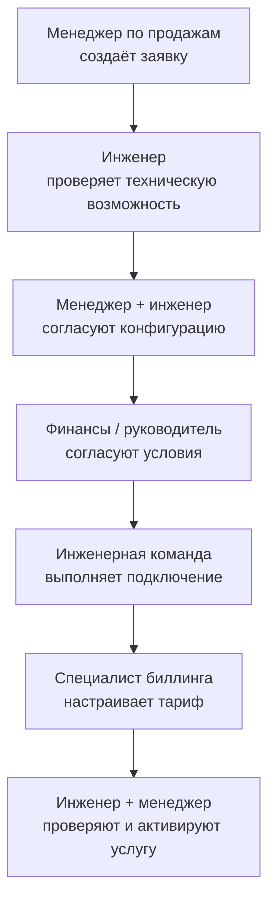
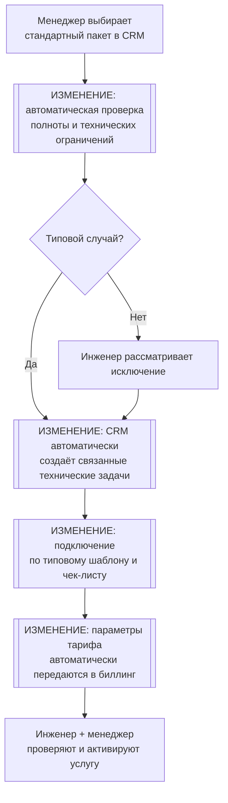
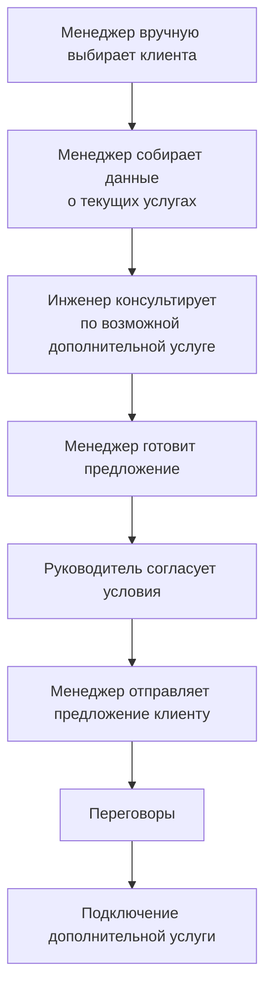
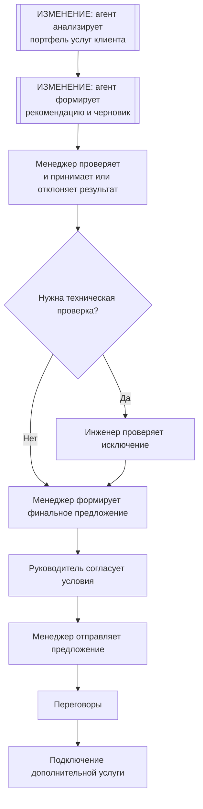

**Курс:** Управление информационными технологиями на предприятии

**Семестр:** осень/зима 2026

**Работа:** Практическая работа №3 — Процессы под гипотезы

**Студент:** Носова Арина Эдуардовна, ИСУ: 336516

> **Бизнес:** ООО «Наука-Связь», оператор связи и ИТ-интегратор.
>
> **Масштаб:** начиная с ПР2 периметр расчёта уточнён относительно ПР1. Для всех финансовых расчётов используется ООО «Наука-Связь» с выручкой **1,95 млрд руб. за 2025 год**. 1% выручки составляет **19,5 млн руб.** Данные группы используются как справочный контекст.
>
> **Направления:** телеком-услуги, ИТ-услуги и системная интеграция, строительство ВОЛС, промышленная автоматизация, производство электротехнической продукции.
>
> **ИТ-функция:** поставщик услуг, зона 🔴. Около 40% ИТ-вакансий длительно не закрываются, текучесть ИТ-персонала достигла 20%, поток запросов бизнеса вырос в 1,5 раза. Часть ИТ-специалистов участвует в оказании продаваемых клиентам услуг.
>
> **Ограничения:** внутренние данные о времени операций, загрузке сотрудников, стоимости труда и конверсии публично не раскрываются. Значения без фактического замера явно отмечены как допущения. Для каждого такого значения указан способ последующей проверки.

# Процессы под гипотезы

**Цель работы:** перепроектировать процессы, через которые реализуются принятые в ПР2 гипотезы, определить исходную точку, показать потери, описать изменения с опорой на ITIL 4 и DevOps и определить место агента в новом процессе.

В ПР2 в работу были взяты три гипотезы:

- допродажи существующей клиентской базе
- удержание и переподготовка сотрудников
- стандартизация и цифровизация подключения новых B2B-клиентов

Для ПР3 выбраны два процесса, которые напрямую влияют на выручку и используют один и тот же дефицитный инженерный ресурс:

- **процесс подключения нового типового B2B-клиента**, который реализует гипотезу «Стандартизация и цифровизация подключения»
- **процесс допродажи существующему B2B/B2G-клиенту**, который реализует гипотезу «Допродажи существующей клиентской базе»

Гипотеза про удержание и переподготовку сотрудников остаётся ресурсным условием для обоих процессов. В ПР3 она учитывается через ограничение доступной инженерной мощности, но отдельный HR-процесс не моделируется, чтобы не расширять работу третьим процессом.

# Связь процессов с гипотезами ПР2

| Процесс | Гипотеза из ПР2 | Через какой шаг реализуется гипотеза |
|---|---|---|
| Подключение нового типового B2B-клиента | Стандартизация и цифровизация подключения | Проектирование, проверка технической возможности, постановка задач на подключение и передача параметров в биллинг |
| Допродажа существующему клиенту | Допродажи существующей клиентской базе | Выбор клиента, анализ уже используемых услуг, формирование предложения и подключение дополнительной услуги |

Для обоих процессов действует общий ресурсный приоритет из ПР2:

1. эксплуатация услуг, нарушение которых ведёт к потере действующей выручки или SLA
2. работы, связанные с привлечением и обслуживанием новых клиентов
3. обязательные работы по ИБ и регуляторным требованиям
4. автоматизация, снижающая расход дефицитного инженерного труда
5. остальные изменения

# Процесс подключения нового типового B2B-клиента до изменения

Процесс начинается после согласования коммерческих условий и заканчивается началом биллинга по подключённой услуге.

Фактические внутренние данные компании недоступны. Поэтому временные значения ниже являются допущениями ПР3. Они нужны как предварительная исходная точка. До пилота значения должны быть заменены выгрузкой из CRM, Service Desk, системы технических заявок и биллинга за последние 3 месяца.

## Схема процесса до изменения

## Таблица потерь до изменения

| Шаг | Роль | Время работы | Время ожидания | В чём потеря | Источник замера |
|---|---|---:|---:|---|---|
| Создание и проверка заявки | Менеджер по продажам | 0,75 ч | 4 ч | повторный ввод параметров клиента, ожидание проверки полноты заявки | CRM, выборка новых подключений за 3 месяца, владелец данных: руководитель продаж |
| Проверка технической возможности | Сетевой или проектный инженер | 2,5 ч | 24 ч | заявка ждёт свободного инженера, часть данных приходится уточнять | система технических заявок, 3 месяца, владелец: руководитель инженерного блока |
| Формирование технической конфигурации | Менеджер по продажам + инженер | 3 ч | 16 ч | индивидуальная проработка типовых случаев | CRM + Service Desk, 3 месяца, владельцы: продажи и ИТ |
| Внутреннее согласование | Руководитель направления / финансы | 1 ч | 16 ч | последовательное согласование | CRM или СЭД, 3 месяца, владелец: коммерческий директор |
| Подключение и настройка | Инженерная команда | 12 ч | 48 ч | ожидание очереди исполнения, ручная постановка отдельных задач | Service Desk / система технических работ, 3 месяца, владелец: руководитель эксплуатации |
| Настройка биллинга | Специалист биллинга | 1,5 ч | 12 ч | повторный перенос параметров из заявки | биллинг + Service Desk, 3 месяца, владелец: руководитель биллинга |
| Приёмка и активация | Инженер + менеджер | 3,25 ч | 16 ч | ожидание подтверждений и ручная сверка | Service Desk + CRM, 3 месяца, владельцы: инженерный блок и продажи |
| **Итого** |  | **24 ч** | **136 ч** |  |  |

Полное расчётное время цикла:

**24 ч работы + 136 ч ожидания = 160 ч = 20 рабочих дней**

Доля ожидания:

**136 / 160 × 100% = 85%**

Главная потеря находится во времени ожидания. Самые крупные участки:

- ожидание исполнения подключения: 48 ч
- ожидание технической проверки: 24 ч
- согласование конфигурации и внутренних условий: 32 ч суммарно

Трудоёмкость одного типового подключения составляет **24 человеко-часа**. В ПР2 это значение было задано как допущение, в ПР3 оно раскладывается по конкретным шагам.

# Процесс подключения нового типового B2B-клиента после изменения

Изменения применяются только к типовым подключениям. По гипотезе ПР2 предполагается, что не менее 70% подключений целевого сегмента можно провести по стандартному маршруту.

## Схема процесса после изменения

## Изменения и связь с потерями

| Изменение | Какую потерю убирает | Гипотеза ПР2 | Ожидаемое время работы | Ожидаемое ожидание |
|---|---|---|---:|---:|
| Стандартный пакет и обязательные поля в CRM | повторный ввод данных и возврат неполной заявки | Стандартизация и цифровизация подключения | 0,5 ч | 1 ч |
| Автоматическая предварительная техническая проверка | очередь на инженера для типовых случаев | Стандартизация и цифровизация подключения | 1,5 ч в среднем с учётом исключений | 16 ч |
| Типовая конфигурация услуги | индивидуальное проектирование стандартного подключения | Стандартизация и цифровизация подключения | 1,5 ч | 8 ч |
| Упрощённое согласование типового пакета | последовательное согласование уже утверждённых условий | Стандартизация и цифровизация подключения | 0,5 ч | 8 ч |
| Автоматическое создание связанных задач | ручная передача между продажами и техническими подразделениями | Стандартизация и цифровизация подключения | включено в системную операцию | включено в системную операцию |
| Подключение по шаблону и чек-листу | повторная настройка типовых элементов | Стандартизация и цифровизация подключения | 10 ч | 40 ч |
| Автоматическая передача параметров тарифа в биллинг | повторный ввод данных | Стандартизация и цифровизация подключения | 1 ч | 5 ч |
| Приёмка и активация | ручная сверка нескольких источников | Стандартизация и цифровизация подключения | 3 ч | 16 ч |
| **Итого** |  |  | **18 ч** | **94 ч** |

Полное ожидаемое время:

**18 ч работы + 94 ч ожидания = 112 ч = 14 рабочих дней**

Изменение относительно исходной точки:

- время цикла сокращается с 20 до 14 рабочих дней, то есть на **30%**
- трудоёмкость сокращается с 24 до 18 человеко-часов, то есть на **25%**
- доля ожидания снижается с 85% до **84%**

Последний показатель меняется незначительно. Основной эффект возникает за счёт уменьшения абсолютного времени ожидания и трудоёмкости.

# Расчёт эффекта процесса подключения

Для расчёта используется инженерная ёмкость, а не произвольно выбранный процент выручки.

Допущения ПР3:

- на типовые подключения фактически выделен ресурс, эквивалентный **3 инженерам**
- один инженер располагает примерно **1440 продуктивными часами в год** после отпусков, внутренних встреч, обучения и административной нагрузки
- суммарная доступная ёмкость составляет **4320 ч в год**
- средняя годовая выручка с одного нового типового клиента принимается равной **195 тыс. руб.**

До изменения:

**4320 / 24 = 180 подключений в год**

После изменения:

**4320 / 18 = 240 подключений в год**

Дополнительная ёмкость:

**240 − 180 = 60 подключений в год**

Потенциальный дополнительный эффект:

**60 × 195 тыс. руб. = 11,7 млн руб. в год**

Относительно базы 1,95 млрд руб.:

**11,7 / 1950 × 100% = 0,6% выручки**

Эффект находится внутри отраслевого коридора **0,2–1%** для одного улучшения на выручку.

Эффект считается только при фактически подключённых и начавших оплачиваться клиентах. Созданная заявка или подготовленная конфигурация в результат не засчитываются.

# Trade-off процесса подключения

Стандартизация ускоряет типовые подключения, но ухудшает условия для нетиповых случаев.

В модели предполагается, что:

- 70% подключений проходят по стандартному маршруту
- 30% попадают в маршрут исключений

Для исключений появляется дополнительная стадия автоматической проверки и последующей передачи инженеру. Их ожидаемый срок увеличивается с 20 до **22 рабочих дней**, то есть примерно на **10%**.

Устойчивый trade-off:

> большинство типовых клиентов подключается быстрее, но клиент с нестандартной конфигурацией может ждать дольше из-за отдельной очереди исключений.

Поэтому в пилоте нужно контролировать не только медиану, но и 90-й перцентиль времени подключения. Если ускорение типового потока приводит к росту 90-го перцентиля более чем на 20%, маршрут исключений потребуется переработать.

# Процесс допродажи существующему клиенту до изменения

Процесс начинается с выбора клиента менеджером и заканчивается подключением дополнительной услуги.

Сейчас допродажи зависят от инициативы конкретного менеджера. В ПР2 была выбрана гипотеза системного анализа клиентской базы через CRM.

Временные показатели ниже являются допущениями. До пилота они должны быть проверены на истории коммерческих предложений и заказов за 12 месяцев.

## Схема процесса до изменения

## Таблица потерь до изменения

| Шаг | Роль | Время работы | Время ожидания | В чём потеря | Источник замера |
|---|---|---:|---:|---|---|
| Выбор клиента | Менеджер по продажам | 0,5 ч | 16 ч | поиск вручную, клиент выбирается по опыту менеджера | CRM за 12 месяцев, владелец: коммерческий директор |
| Сбор данных об услугах | Менеджер по продажам | 0,75 ч | 8 ч | данные собираются из нескольких записей и систем | CRM + биллинг, 12 месяцев, владельцы: продажи и биллинг |
| Техническая консультация | Инженер | 1 ч | 16 ч | ожидание дефицитного инженерного ресурса | Service Desk / внутренние заявки, 12 месяцев, владелец: инженерный блок |
| Подготовка предложения | Менеджер по продажам | 1,5 ч | 8 ч | повторяющаяся ручная работа с похожими предложениями | CRM / СЭД, 12 месяцев, владелец: продажи |
| Согласование условий | Руководитель продаж | 0,5 ч | 8 ч | последовательное согласование | CRM / СЭД, 12 месяцев, владелец: коммерческий директор |
| Отправка и ожидание ответа | Менеджер по продажам | 0,25 ч | 40 ч | ожидание клиента | CRM, 12 месяцев, владелец: продажи |
| Переговоры | Менеджер по продажам | 1,5 ч | 24 ч | несколько циклов уточнений | CRM, 12 месяцев, владелец: продажи |
| Подключение дополнительной услуги | Инженер / эксплуатация | 2 ч | 16 ч | очередь технических работ | Service Desk, 12 месяцев, владелец: эксплуатация |
| **Итого** |  | **8 ч** | **136 ч** |  |  |

Полное расчётное время:

**8 ч работы + 136 ч ожидания = 144 ч = 18 рабочих дней**

Доля ожидания:

**136 / 144 × 100% = 94,4%**

Основные потери:

- ручной поиск клиента и сбор данных
- ожидание инженерной консультации
- ручная подготовка похожих предложений
- отсутствие системного признака, какой клиент и какая услуга имеют наибольшую вероятность допродажи

Для оценки конверсии вводится исходное допущение:

> среди клиентов, которым менеджеры вручную предлагают дополнительную услугу, текущая конверсия в продажу составляет около **8%**.

Значение должно быть проверено по CRM за последние 12 месяцев как отношение числа оплачиваемых дополнительных услуг к числу зафиксированных коммерческих предложений.

# Процесс допродажи существующему клиенту после изменения

В процесс добавляется внутренний агент. Он помогает отбирать клиентов и готовить черновик предложения, но не принимает коммерческое решение и не отправляет сообщение клиенту самостоятельно.

## Схема процесса после изменения

## Изменения и связь с потерями

| Изменение | Какую потерю убирает | Гипотеза ПР2 | Ожидаемое время работы | Ожидаемое ожидание |
|---|---|---|---:|---:|
| Агент выбирает клиентов по набору используемых услуг | ручной поиск и зависимость от памяти менеджера | Допродажи существующей клиентской базе | 0,1 ч системного времени | 0,1 ч |
| Агент собирает данные из CRM и биллинга | ручной сбор информации | Допродажи существующей клиентской базе | включено в предыдущий шаг | включено |
| Агент готовит рекомендацию и черновик | повторяющаяся подготовка похожих предложений | Допродажи существующей клиентской базе | 0,05 ч системного времени | 0,1 ч |
| Менеджер принимает результат агента | риск ошибочной или неуместной рекомендации | Допродажи существующей клиентской базе | 0,17 ч | 4 ч |
| Инженер проверяет только исключения | очередь инженерных консультаций по типовым услугам | Допродажи существующей клиентской базе | 0,4 ч в среднем | 8 ч |
| Шаблон коммерческого предложения | повторный набор структуры предложения | Допродажи существующей клиентской базе | 0,4 ч | 4 ч |
| Остальная часть клиентского цикла | не меняется радикально | Допродажи существующей клиентской базе | 2,85 ч | 76 ч |
| **Итого** |  |  | **около 4 ч** | **около 92 ч** |

Полное ожидаемое время:

**4 ч работы + 92 ч ожидания = 96 ч = 12 рабочих дней**

Сокращение относительно исходной точки:

- время цикла: с 18 до 12 рабочих дней, примерно на **33%**
- ручная трудоёмкость: с 8 до 4 человеко-часов, примерно на **50%**

# Место агента

## Какие шаги передаются агенту

Агент выполняет только повторяющуюся аналитическую и текстовую работу:

- определяет, каких услуг нет у выбранного клиента
- сопоставляет профиль клиента с каталогом доступных услуг
- ранжирует возможные дополнительные предложения
- формирует черновик обоснования для менеджера
- формирует черновик коммерческого предложения по утверждённому шаблону

Агент не общается с клиентом самостоятельно.

## Что агент видит и чем действует

Агент получает доступ только к тем данным, которые нужны для выбора услуги:

- идентификатор компании
- отрасль и сегмент
- перечень действующих услуг
- тарифная категория
- история обращений в агрегированном виде
- признаки использования дополнительных сервисов
- утверждённый каталог услуг и стандартные условия

Права агента:

- чтение разрешённых полей CRM и биллинга
- чтение каталога услуг
- создание черновика рекомендации
- создание черновика задачи в CRM

Агент не получает права:

- изменять договор
- менять цену
- создавать счёт
- активировать услугу
- отправлять письмо клиенту
- самостоятельно выдавать доступы

Персональные данные контактных лиц в запрос к модели не передаются. Для анализа используется идентификатор организации и обезличенный набор признаков.

## Кто принимает результат и сколько это стоит

Результат принимает **менеджер по работе с клиентом**.

Допущения:

- агент обрабатывает 150 клиентов пилотной выборки
- проверка одного результата менеджером занимает 10 минут
- расчётная полная стоимость часа менеджера составляет 1200 руб.
- вычислительная стоимость обработки одного клиента агентом принимается равной 30 руб.

Стоимость приёмки:

**150 × 10 / 60 × 1200 = 30 000 руб.**

Стоимость работы агента:

**150 × 30 = 4 500 руб.**

Общие прямые затраты на агента и приёмку:

**34 500 руб.**

До изменения ручной выбор клиента, сбор информации и подготовка предложения занимают:

**0,5 + 0,75 + 1,5 = 2,75 ч на клиента**

Для 150 клиентов:

**150 × 2,75 × 1200 = 495 000 руб.**

Расчётное снижение трудовых и вычислительных затрат на эту часть процесса:

**495 000 − 34 500 = 460 500 руб.**

Экономия ниже отраслевого коридора для отдельного улучшения на уровне всей компании и не считается самостоятельным улучшением ПР2. Агент поддерживает гипотезу роста выручки и высвобождает время менеджеров.

Цена приёмки уже вычтена из расчёта экономии.

## Что агенту не передаётся

Агенту не передаются:

- утверждение индивидуальной цены
- юридически значимое согласование условий
- решение о предоставлении скидки
- отправка клиенту финального предложения
- изменение договора
- решение о подключении нестандартной технической схемы
- работа с персональными данными, которые не требуются для сегментации

Причина ограничения состоит в том, что ошибка в этих шагах может привести к финансовым, договорным и репутационным последствиям, которые обнаруживаются уже после взаимодействия с клиентом.

# Расчёт эффекта процесса допродаж

В ПР2 для гипотезы был указан валовой ориентир **15,6 млн руб.**, рассчитанный для программы из 150 клиентов при конверсии 20% и средней дополнительной годовой выручке 520 тыс. руб.

ПР3 добавляет исходную точку и отделяет существующую конверсию от прироста процесса.

Допущения:

- пилотная группа: 150 клиентов
- текущая конверсия ручных допродаж: 8%
- целевая конверсия после изменения: 20%
- средняя дополнительная годовая выручка одного клиента, купившего дополнительную услугу: 520 тыс. руб.

До изменения:

**150 × 8% = 12 дополнительных продаж**

**12 × 520 тыс. руб. = 6,24 млн руб. годовой выручки**

После изменения:

**150 × 20% = 30 дополнительных продаж**

**30 × 520 тыс. руб. = 15,6 млн руб. годовой выручки**

Чистый дополнительный эффект относительно исходной точки:

**15,6 − 6,24 = 9,36 млн руб.**

Относительно выручки ООО:

**9,36 / 1950 × 100% = 0,48%**

Из эффекта отдельно учитываются прямые затраты на агента и приёмку:

**9,36 млн − 0,0345 млн = 9,3255 млн руб.**

Округлённый эффект:

**9,33 млн руб. в год**

Эффект составляет около **0,48% выручки** и находится внутри отраслевого коридора **0,2–1%**.

В ПР2 был указан валовой эффект 0,8%. В ПР3 после появления исходной точки финансовый эффект уточнён до 0,48%. Валовые 15,6 млн руб. остаются целевой выручкой программы, а 9,33 млн руб. показывают прирост относительно существующего уровня.

Эффект считается только по дополнительным услугам, которые были приняты клиентом, активированы и начали приносить выручку.

# Trade-off процесса допродаж

Агент и шаблоны снижают ручную нагрузку, но увеличивают риск менее персонализированных рекомендаций.

Для пилота вводятся ограничения:

- не менее 70% рекомендаций агента должны быть приняты менеджером без полной переработки
- не более 10% принятых рекомендаций должны требовать глубокой ручной корректировки
- если доля отказов клиентов с причиной «не соответствует потребности» вырастет более чем на 5 процентных пунктов относительно исходного уровня, модель сегментации пересматривается

При 150 обработанных клиентах и ожидаемой доле отклонения результата агентом менеджером 30%:

**45 черновиков будут подготовлены и проверены без дальнейшего использования**

Стоимость такой работы:

**45 × (100 руб. приёмки + 30 руб. вычислений) = 5 850 руб.**

Это постоянная цена автоматизированного отбора. Она небольшая относительно финансового эффекта, но показывает, что часть работы агента неизбежно не превращается в принятый результат.

# Практики ITIL 4

В работу включаются только практики, которые действительно меняются в выбранных процессах.

| Практика ITIL 4 | Почему попадает в работу | Что меняется |
|---|---|---|
| Service request management | подключение типовой услуги начинается с клиентского запроса | появляется стандартная форма заявки, обязательные поля, типовой маршрут и автоматическая постановка связанных задач |
| Service level management | меняется обещаемый срок типового подключения | вводится измеряемый срок подключения для типового пакета и отдельный контроль маршрута исключений |
| Change enablement | автоматизация затрагивает CRM, технический контур и биллинг | изменения проходят через ограниченный пилот, проверяются до промышленного запуска и имеют план отката |
| Monitoring and event management | после автоматизации нужно видеть ошибки передачи данных между системами | контролируются ошибки создания задач, передачи тарифа и статуса активации |
| Supplier management | часть работ может выполнять аккредитованный внешний подрядчик при дефиците внутренних специалистов | подрядчик работает по тем же шаблонам, SLA и требованиям передачи результата на сопровождение |

Incident management и Problem management отдельно не включаются, поскольку выбранные гипотезы связаны со скоростью подключения и продажами, а не с повторяющимися авариями.

# DORA

У ООО «Наука-Связь» есть собственная разработка, а гипотеза стандартизации подключения требует изменений CRM, интеграций и биллинга. Поэтому DORA учитывается для цифровой части процесса.

Публичных базовых значений DORA компании нет. Для предварительной модели вводятся допущения, которые до начала пилота должны быть заменены данными репозиториев, CI/CD и Service Desk за последние 3 месяца.

| Показатель DORA | Предварительная исходная точка | Как снять фактическое значение | Владелец данных |
|---|---:|---|---|
| Deployment frequency | 2 выкладки в месяц | число успешных production deployment за 3 месяца | руководитель разработки |
| Lead time for changes | 10 календарных дней | медиана от merge/commit до production | руководитель разработки |
| Change failure rate | 15% | доля выкладок, вызвавших rollback, hotfix или инцидент | руководитель разработки + Service Desk |
| Mean time to restore | 6 часов | медиана от инцидента после изменения до восстановления | эксплуатация / Service Desk |

Для пилота целевые значения DORA не являются самостоятельной целью бизнеса. Они используются как предохранитель. Автоматизация подключения не должна ухудшить Change failure rate выше 20% и Mean time to restore выше 8 часов.

# Совокупный эффект двух процессов

Финансовые эффекты процессов считаются отдельно:

- стандартизация подключения: **11,7 млн руб. в год**
- допродажи после вычета стоимости агента и приёмки: **9,33 млн руб. в год**

Простая арифметическая сумма:

**11,7 + 9,33 = 21,03 млн руб.**

Относительно выручки ООО:

**21,03 / 1950 × 100% = 1,08%**

Это значение используется как предварительный ориентир.

Полный эффект нельзя считать простой суммой без поправки на общий инженерный ресурс. Оба процесса используют одну и ту же инженерную команду для подключения услуг.

Для ПР3 вводится консервативное допущение о пересечении эффектов:

> до 15% эффекта второго процесса может быть ограничено общей инженерной ёмкостью.

Корректировка:

**9,33 × 15% = 1,40 млн руб.**

Предварительный совокупный эффект:

**21,03 − 1,40 = 19,63 млн руб.**

Относительно выручки:

**19,63 / 1950 × 100% ≈ 1,01%**

Показатель находится у нижней границы отраслевого коридора **1–3%** для набора улучшений.

Итоговый совокупный эффект будет пересчитан в ПР5 после получения фактических результатов пилотов.

# Замер до изменения

До запуска пилотов необходимо зафиксировать исходную точку.

## Подключение

За 3 месяца выгружаются:

- дата создания заявки
- дата передачи инженеру
- дата подтверждения технической возможности
- дата начала выполнения
- дата фактического подключения
- дата активации биллинга
- фактические трудозатраты по ролям
- количество возвратов заявки
- доля типовых и нетиповых подключений

Владелец набора данных: ИТ-директор совместно с коммерческим директором.

## Допродажи

За 12 месяцев выгружаются:

- число клиентов, которым делалось дополнительное предложение
- используемые клиентом услуги на дату предложения
- дата создания предложения
- дата отправки
- результат предложения
- дата подключения дополнительной услуги
- годовая выручка дополнительной услуги
- причина отказа, если она зафиксирована

Владелец набора данных: коммерческий директор.

До получения этих выгрузок значения времени, конверсии и трудоёмкости остаются в реестре допущений.

# Реестр допущений

| № | Допущение | Значение | Откуда оценка | Уверенность | Кто проверит |
|---|---|---:|---|---|---|
| D1 | Среднее время подключения до изменения | 20 рабочих дней | модель ПР2, разложена по шагам ПР3 | низкая | ИТ-директор, выгрузка CRM и Service Desk за 3 месяца |
| D2 | Трудоёмкость подключения | 24 человеко-часа | модель ПР2, разложена по ролям | низкая | руководитель инженерного блока |
| D3 | Инженерный ресурс типовых подключений | эквивалент 3 FTE | расчётное допущение для модели мощности | низкая | ИТ-директор |
| D4 | Продуктивное время одного инженера | 1440 ч в год | расчётное допущение с учётом отпусков и внутренней нагрузки | средняя | HR + руководитель инженерного блока |
| D5 | Средняя годовая выручка нового типового клиента | 195 тыс. руб. | расчёт ПР2 для гипотезы стандартизации | низкая | коммерческий директор по договорам за 2025–2026 |
| D6 | Доля типовых подключений | 70% | порог гипотезы ПР2 | низкая | инженерный блок по пилоту |
| D7 | Срок нетипового подключения после изменения | 22 рабочих дня | расчётный trade-off маршрута исключений | низкая | ИТ-директор по пилоту |
| D8 | Текущее время процесса допродажи | 18 рабочих дней | разложение процесса ПР3 | низкая | коммерческий директор по CRM |
| D9 | Текущая конверсия ручных допродаж | 8% | расчётное допущение для отделения исходной точки | низкая | коммерческий директор по CRM за 12 месяцев |
| D10 | Целевая конверсия допродаж | 20% | расчёт ПР2 | средняя | результаты пилота |
| D11 | Средняя годовая выручка дополнительной услуги | 520 тыс. руб. | расчёт ПР2 | низкая | коммерческий директор по действующим договорам |
| D12 | Стоимость часа менеджера | 1200 руб. | расчётное допущение полной стоимости труда | низкая | HR + финансовый директор |
| D13 | Стоимость обработки одного клиента агентом | 30 руб. | предварительная оценка вычислительных затрат | низкая | ИТ-директор по фактическому тарифу модели |
| D14 | Доля рекомендаций агента, принимаемых менеджером | не менее 70% | порог качества пилота | низкая | руководитель продаж |
| D15 | Пересечение финансовых эффектов процессов | 15% эффекта допродаж | консервативное допущение общего инженерного ограничения | низкая | ИТ-директор после двух пилотов |
| D16 | Deployment frequency | 2 раза в месяц | предварительная DORA-модель | низкая | руководитель разработки |
| D17 | Lead time for changes | 10 дней | предварительная DORA-модель | низкая | руководитель разработки |
| D18 | Change failure rate | 15% | предварительная DORA-модель | низкая | разработка + Service Desk |
| D19 | Mean time to restore | 6 часов | предварительная DORA-модель | низкая | эксплуатация + Service Desk |

