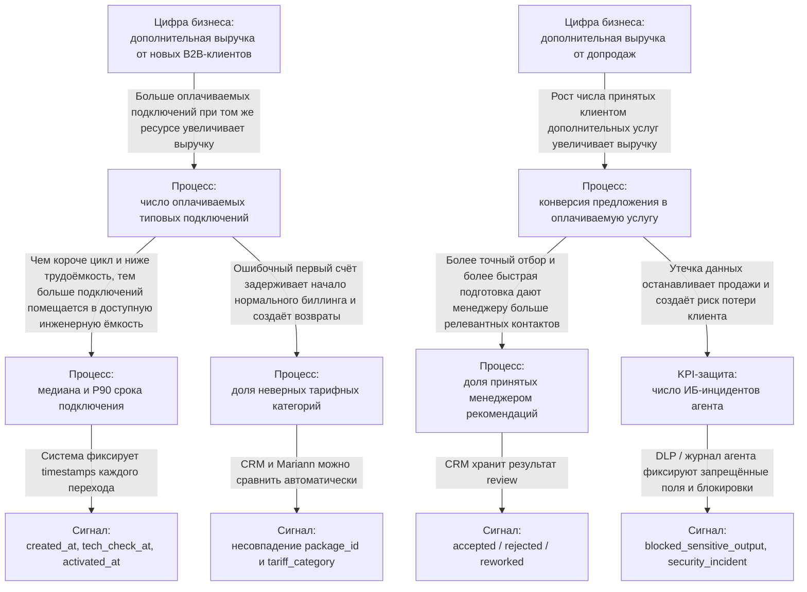

# Практическая работа №4 — Показатели, модель и бюджет

**Курс:** Управление информационными технологиями на предприятии

**Семестр:** осень/зима 2026

**Студент:** Носова Арина Эдуардовна, ИСУ: 336516

> **Бизнес:** ООО «Наука-Связь», оператор связи и ИТ-интегратор.
>
> **Масштаб:** с ПР2 единым периметром расчёта является ООО «Наука-Связь». Выручка за 2025 год составляет **1,95 млрд руб.**, поэтому 1% выручки равен **19,5 млн руб.**
>
> **Направления:** телеком-услуги, ИТ-услуги и системная интеграция, строительство ВОЛС, промышленная автоматизация, производство электротехнической продукции.
>
> **ИТ-функция:** поставщик услуг, зона 🔴. Около 40% ИТ-вакансий длительно не закрываются, текучесть ИТ-персонала достигла 20%, поток запросов бизнеса вырос в 1,5 раза. Часть ИТ-специалистов участвует в оказании продаваемых услуг.
>
> **Ограничения:** внутренних выгрузок CRM, Service Desk, Mariann, Git/CI и фактической себестоимости труда нет. Значения без фактического замера отмечены как допущения. После лебедей 4 и 6 часть показателей уже имеет сценарные наблюдения: 10% ошибочных тарифных категорий, 2 отката из 6 выкладок, Change Failure Rate 33,3%, восстановление более 8 часов и один подтверждённый случай раскрытия данных другого клиента.

# Показатели, модель и бюджет

**Цель работы:** построить систему показателей для процессов из ПР3, проверить ожидаемый эффект в модели до масштабирования и определить бюджет с критериями продолжения и остановки.

В ПР3 рассматривались два процесса:

- подключение нового типового B2B-клиента
- допродажа существующему B2B/B2G-клиенту

После лебедя 4 процесс подключения дополнился контролем тарифного справочника и первого счёта.

После лебедя 6 агент допродаж переведён на ограниченный набор структурированных данных. B2G-клиенты с повышенными требованиями к защите сведений временно идут по ручному маршруту.

# Дерево показателей

Для каждого показателя используется одна логика: системный сигнал должен объяснять состояние процесса, а показатель процесса должен быть связан с финансовым результатом.

## Логика связей

| Верхний показатель | Нижний показатель | Почему связь важна | Количественная связь в модели |
|---|---|---|---|
| Дополнительная выручка новых B2B-клиентов | Число оплачиваемых подключений | выручка появляется только после подключения и начала оплаты | 1 дополнительное оплачиваемое подключение даёт фактическую годовую выручку клиента. В сценарной модели используется 195 тыс. руб. на клиента |
| Число подключений | Трудоёмкость и срок подключения | при ограниченном инженерном ресурсе снижение трудоёмкости увеличивает пропускную способность | при 1700 ч на 1 FTE переход с 24 до 17,75 ч увеличивает расчётную мощность примерно с 70,8 до 95,8 подключения на FTE в год, то есть примерно на 24,9 подключения |
| Выручка от подключения | Доля ошибок первого счёта | ошибка тарифа задерживает расчёты и требует ручного исправления | показатель используется как защитное ограничение. При ошибке выше 1% масштабирование прекращается, даже если срок подключения сокращён |
| Выручка от допродаж | Конверсия в оплачиваемую услугу | черновик и предложение не дают финансового эффекта до активации услуги | рост конверсии на 1 п.п. при 1200 клиентах и среднем эффекте 520 тыс. руб. даёт около 6,24 млн руб. валовой дополнительной выручки |
| Конверсия | Принятие рекомендации менеджером | отклонённая рекомендация требует ручной работы и не создаёт преимуществ автоматизации | каждый дополнительный 1 п.п. отклонённых черновиков при 1200 клиентах добавляет 12 ручных доработок, или 21,6 тыс. руб. затрат при 1,5 ч и 1200 руб./ч |
| Выручка от допродаж | ИБ-инциденты | утечка данных может остановить расширение договора и перевести сегмент на ручной маршрут | связь задаётся как stop-критерий: 1 подтверждённый новый инцидент раскрытия данных останавливает масштабирование агента |

# KPI и OKR

KPI используются как ограничения, которые нельзя ухудшить ради роста. OKR используются для изменения процессов за ограниченный период.

## KPI

| KPI | Текущее значение | Порог | Как можно натянуть показатель | Защита от натягивания |
|---|---:|---:|---|---|
| Доля первых счетов, отправленных клиенту с неверной тарифной категорией | 10% по лебедю 4 до возврата контроля | ≤1% | исправлять ошибку до регистрации и считать такой случай корректным | отдельно считать внутренние несоответствия до ручной коррекции и ошибки, ушедшие клиенту |
| Change Failure Rate интеграции CRM → Mariann | 33,3%, 2 из 6 выкладок | ≤20% | реже выпускать изменения и формально снизить число провалов | вместе смотреть Deployment Frequency и число отложенных исправлений |
| Failed Deployment Recovery Time | >8 ч | ≤8 ч | закрывать инцидент до фактического восстановления биллинга | окончание инцидента фиксировать по восстановлению корректного расчёта тестового счёта |
| ИБ-инциденты агента с чужими данными | 1 подтверждённый случай по лебедю 6 | 0 | не регистрировать заблокированные попытки как инциденты | отдельно считать фактические инциденты и срабатывания защитного фильтра |
| P90 срока нетипового подключения | 22 рабочих дня, допущение ПР3 | ≤22 дней | переводить сложные подключения из выборки | тип подключения фиксируется в момент регистрации заявки и не меняется задним числом |
| Доля B2G-клиентов, прошедших агентский маршрут без допуска ИБ | после лебедя 6 должна быть 0% | 0% | формально считать клиента B2B | сегмент определяется по карточке договора, владелец справочника коммерческий директор |

## OKR

### Objective: ускорить типовое подключение без повторения ошибок тарификации

**Горизонт:** 6 месяцев.

Key Results:

- снизить медиану полного цикла типового подключения с расчётных 20 до **не более 15 рабочих дней**
- снизить трудоёмкость одного типового подключения с 24 до **не более 19 человеко-часов**
- добиться доли неверных тарифных категорий, ушедших клиенту, **не более 1%**
- после стабилизации оставить ручную сверку не более чем для **10% первых счетов**

Как можно натянуть OKR:

- выбирать только самые простые подключения
- переносить сложные заявки в категорию исключений
- снижать срок за счёт роста незавершённой работы

Компенсация:

- дополнительно контролируются P90 срока
- доля исключений
- число незавершённых заявок
- критерий типового подключения фиксируется при создании заявки

### Objective: восстановить безопасные допродажи и доказать полезность агента

**Горизонт:** 6 месяцев.

Key Results:

- провести контролируемый пилот минимум на **150 клиентах**
- добиться принятия менеджером без полной ручной переделки минимум **70% черновиков**
- получить конверсию тестовой группы не ниже **8,8%** при исходной оценке 8%
- не допустить ни одного раскрытия данных другого клиента
- после успешного пилота подтвердить возможность масштабирования минимум до **1200 подходящих клиентов в год**

Как можно натянуть OKR:

- отобрать в тест только клиентов с высокой вероятностью покупки
- не включать отклонённые черновики в знаменатель
- считать отправленное предложение продажей

Компенсация:

- контрольная и тестовая группы формируются до запуска
- знаменатель acceptance rate включает все созданные черновики
- продажей считается только активированная и оплачиваемая дополнительная услуга

# Паспорта метрик

## Метрика: дополнительная выручка новых типовых B2B-клиентов

| Поле | Значение |
|---|---|
| Название и единица | Дополнительная годовая выручка новых типовых B2B-клиентов, руб. |
| Формула | сумма годовой выручки по новым типовым клиентам сверх базового объёма подключений. Для каждого принятого результата используется фактический MRR первого полного месяца × 12. В выборку входят только клиенты с `standard_connection = true`, активированной услугой и первым корректным счётом |
| Точка съёма | CRM определяет когорту и дату активации, Mariann даёт фактически начисленную выручку. Владелец денежного показателя: финансовый директор. Владелец признака когорты: коммерческий директор |
| Частота | ежемесячно после закрытия биллингового периода, задержка до 10 рабочих дней |
| Целевое значение | ожидаемый сценарий 7,8 млн руб. в год при 40 дополнительных оплачиваемых подключениях. Значение пересчитывается после подтверждения фактического спроса и среднего MRR |
| Что искажает | сезонность подключений, скидки первых месяцев, бесплатный период, ошибочная классификация клиента как типового, изменение тарифа после подключения |

## Метрика: дополнительная выручка от допродаж

| Поле | Значение |
|---|---|
| Название и единица | Чистая дополнительная годовая выручка от программы допродаж, руб. |
| Формула | для тестовой группы: фактическая annualized revenue активированных дополнительных услуг минус ожидаемая annualized revenue при конверсии контрольной группы. Денежный результат считается только по услугам с `campaign_id` пилота и начавшимся биллингом |
| Точка съёма | CRM хранит тестовую и контрольную группу, предложение и результат. Mariann даёт начисления по дополнительной услуге. Владелец денежного показателя: финансовый директор. Владелец эксперимента: коммерческий директор |
| Частота | промежуточно ежемесячно, финальная оценка после закрытия месяца с задержкой до 10 рабочих дней |
| Целевое значение | не менее 4,0 млн руб. чистой дополнительной выручки в год после масштабирования. Цель проверяется только при конверсии теста выше контроля |
| Что искажает | разные скидки между группами, продажи вне CRM, перенос существующей продажи в кампанию, сезонность, неполный месяц биллинга |

## Метрика: медиана срока типового подключения

| Поле | Значение |
|---|---|
| Название и единица | Медиана срока типового подключения, рабочие дни |
| Формула | median(activated_at − request_created_at) для заявок, которые при создании получили признак `standard_connection = true` |
| Точка съёма | CRM + Service Desk, владелец данных: ИТ-директор совместно с коммерческим директором |
| Частота | ежедневно, отчёт с задержкой не более 1 дня |
| Целевое значение | ≤15 рабочих дней. Цель чуть хуже расчётных 14,3 дня из ПР3, чтобы учитывать ручной контроль после лебедя 4 |
| Что искажает | изменение признака типового подключения, праздники, неполные timestamps, остановка работ по просьбе клиента |

## Метрика: P90 срока типового подключения

| Поле | Значение |
|---|---|
| Название и единица | 90-й перцентиль срока типового подключения, рабочие дни |
| Формула | percentile90(activated_at − request_created_at) по той же фиксированной выборке |
| Точка съёма | CRM + Service Desk, владелец: ИТ-директор |
| Частота | еженедельно |
| Целевое значение | ≤18 рабочих дней |
| Что искажает | малый размер выборки, единичные остановки по вине клиента |

## Метрика: трудоёмкость типового подключения

| Поле | Значение |
|---|---|
| Название и единица | Средняя трудоёмкость принятого подключения, человеко-часы |
| Формула | сумма фактических часов всех ролей / число подключений, по которым начался биллинг |
| Точка съёма | Service Desk + табель / учёт трудозатрат, владелец: руководитель инженерного блока |
| Частота | ежемесячно |
| Целевое значение | ≤19 человеко-часов |
| Что искажает | неполное списание времени, перенос работы между сотрудниками, внеплановые выезды |

## Метрика: ошибка тарифной категории первого счёта

| Поле | Значение |
|---|---|
| Название и единица | Доля первых счетов с неверной тарифной категорией, % |
| Формула | число первых счетов, где фактическая tariff_category отличается от утверждённой категории заказа / все первые счета × 100% |
| Точка съёма | CRM + Mariann + журнал ручной сверки, владелец: финансовый директор |
| Частота | ежедневно |
| Целевое значение | клиентская ошибка ≤1%. Внутреннее несоответствие до ручной коррекции отдельно показывается и не должно превышать 3% |
| Что искажает | ручное исправление без регистрации, изменение тарифа после подключения |

## Метрика: Change Failure Rate

| Поле | Значение |
|---|---|
| Название и единица | Доля неудачных production-изменений, % |
| Формула | deployment, вызвавшие rollback, hotfix или инцидент / все production deployment × 100% |
| Точка съёма | CI/CD + Service Desk, владелец: руководитель разработки |
| Частота | после каждой выкладки, сводка ежемесячно |
| Целевое значение | ≤20% |
| Что искажает | слишком редкие выкладки, различная тяжесть изменений, незарегистрированные hotfix |

## Метрика: Failed Deployment Recovery Time

| Поле | Значение |
|---|---|
| Название и единица | Время восстановления после неудачной выкладки, часы |
| Формула | restore_confirmed_at − failure_detected_at |
| Точка съёма | CI/CD + мониторинг + Service Desk, владелец: эксплуатация |
| Частота | по каждому инциденту |
| Целевое значение | ≤8 часов |
| Что искажает | преждевременное закрытие инцидента, временный workaround без восстановления функции |

## Метрика: конверсия допродаж

| Поле | Значение |
|---|---|
| Название и единица | Конверсия предложения в оплачиваемую дополнительную услугу, % |
| Формула | число клиентов с активированной дополнительной услугой / число клиентов, включённых в заранее зафиксированную выборку × 100% |
| Точка съёма | CRM + биллинг, владелец: коммерческий директор |
| Частота | еженедельно, финальная оценка через месяц после последнего контакта |
| Целевое значение | ≥8,8% для тестовой группы и не хуже контрольной группы |
| Что искажает | ручной выбор наиболее перспективных клиентов, разные скидки между группами, продажи вне CRM |

## Метрика: acceptance rate рекомендаций агента

| Поле | Значение |
|---|---|
| Название и единица | Доля черновиков, принятых менеджером без полной ручной подготовки, % |
| Формула | accepted_without_full_rewrite / all_agent_drafts × 100% |
| Точка съёма | CRM, владелец: руководитель продаж |
| Частота | ежедневно, сводка еженедельно |
| Целевое значение | ≥70% |
| Что искажает | менеджер может формально принять черновик и затем полностью переписать его вне CRM |

## Метрика: ИБ-инциденты агента

| Поле | Значение |
|---|---|
| Название и единица | Число подтверждённых случаев раскрытия данных другого клиента |
| Формула | count(security_incident = confirmed AND source = agent) |
| Точка съёма | SIEM / DLP / журнал агента + система ИБ-инцидентов, владелец: руководитель ИБ |
| Частота | в реальном времени, сводка ежедневно |
| Целевое значение | 0 |
| Что искажает | отсутствие регистрации, неверная классификация blocked event как отсутствие проблемы |

# Экран руководства

Экран должен помещаться на одной странице и отвечать на три вопроса:

- идём ли мы по плану
- где требуется решение руководства
- что стало хуже

## Макет

| Блок | Метрика | Текущее / исходное | Цель | Зона | Решение |
|---|---|---:|---:|---|---|
| Выручка | Дополнительная выручка новых типовых подключений | пока не подтверждена | ожидаемый сценарий 7,8 млн руб. в год | 🟡 | проверить фактический FTE, спрос и начисления Mariann |
| Выручка | Чистый эффект безопасных допродаж | 0 до пилота | ≥4,0 млн руб. в год после масштабирования | 🟡 | запускать только после безопасного пилота |
| Подключение | Медиана срока | 20 дней, допущение | ≤15 дней | 🟡 | снять фактическую базу за 3 месяца |
| Подключение | P90 срока | нет фактического значения | ≤18 дней | 🟡 | не масштабировать без распределения |
| Биллинг | Ошибка первого счёта | 10% по лебедю 4 | ≤1% клиентских ошибок | 🔴 | приоритет устранению справочников |
| DevOps | Change Failure Rate | 33,3% | ≤20% | 🔴 | freeze функциональных изменений, разрешены исправления |
| DevOps | Recovery Time | >8 ч | ≤8 ч | 🔴 | улучшить rollback и тест первого счёта |
| Допродажи | Конверсия | 8%, допущение | ≥8,8% | 🟡 | A/B-пилот |
| Агент | Acceptance rate | нет факта | ≥70% | 🟡 | измерить на 150 клиентах |
| ИБ | Инциденты утечки | 1 по лебедю 6 | 0 | 🔴 | B2G вручную, подрядчик без доступа до допуска |

## Что теряется при свёртке

Среднее или медиана срока подключения может выглядеть хорошо, когда часть клиентов ждёт значительно дольше. Поэтому рядом с медианой показывается **P90**.

Общая конверсия допродаж может скрыть провал в B2G или отдельной отрасли. На экране выводится общий показатель, но при переходе в детализацию обязательна разбивка:

- B2B / B2G
- агентский / ручной маршрут
- новый / существующий набор услуг

Зелёная зона по ошибкам первого счёта может скрыть рост внутренних исправлений. Поэтому показываются два значения:

- ошибка, ушедшая клиенту
- внутреннее несовпадение CRM и Mariann до ручной коррекции

Для срока подключения и конверсии решения не принимаются только по среднему.

Второй численный разрез на экране показывается для конверсии допродаж:

| Сегмент | Плановый размер группы пилота | Исходная / контрольная конверсия | Целевая конверсия |
|---|---:|---:|---:|
| B2B, контроль | 75 клиентов | 8,0% | используется как фактическая база сравнения |
| B2B, агентский маршрут | 75 клиентов | 8,0% | 8,8% |
| B2G с повышенными требованиями ИБ | показывается отдельно | 8,0%, пока допущение | агент не используется до допуска ИБ |

Разрез не смешивается в одно среднее. Если общая конверсия выглядит зелёной, но B2B-тест проигрывает контролю или B2G ухудшается, масштабирование не проводится.

# Модель в песочнице

Модель объединяет два процесса и считает:

- пропускную способность подключения
- дополнительную выручку
- конверсию допродаж
- стоимость агента и приёмки
- влияние ошибок и контрольных операций
- окупаемость бюджета

## Входные параметры

| Параметр | База | Источник |
|---|---:|---|
| Выручка ООО 2025 | 1,95 млрд руб. | паспорт проекта |
| Трудоёмкость подключения до изменения | 24 ч | ПР3, допущение |
| Трудоёмкость после лебедя 4 | 17,75 ч | ПР3, сумма времён работы по изменённым шагам |
| Производственное время 1 FTE | 1700 ч/год | ПР3, допущение |
| Выручка типового нового клиента | 195 тыс. руб./год | ПР2, допущение |
| Исходная конверсия допродаж | 8% | ПР3, допущение |
| Средняя выручка дополнительной услуги | 520 тыс. руб./год | ПР2, допущение |
| Стоимость часа менеджера | 1200 руб. | ПР3, допущение |
| Стоимость агента на одного клиента | 30 руб. | ПР3, допущение |
| Acceptance rate | 70% | порог ПР3 |
| EBITDA margin для сценарного расчёта окупаемости | 17% | отраслевой ориентир группы, используется как допущение для ООО |

## Внешняя проверка отдельных предположений

Для части параметров модели есть открытые ориентиры. Они используются только для проверки порядка величины и не заменяют внутренние данные ООО «Наука-Связь».

- МТС Бизнес указывает срок подключения интернета или телефонии для бизнеса **от 3 до 10 дней**. Это показывает, что исходные 20 рабочих дней в нашей модели требуют проверки внутренней выгрузкой и могут содержать значительную долю ожидания: https://support.mts.ru/mts_fiksirovannaya_svyaz/podklyuchenie-interneta-i-telefonii-dlya-biznesa/kak-podklyuchit-internet-ili-telefoniyu-dlya-biznesa
- Ростелеком по итогам IV квартала 2025 года указывает ARPU **3 539 руб. в месяц** для B2B/G ШПД на оптике и **4 918 руб.** для B2B/G ШПД + VPN. Это существенно ниже допущения 195 тыс. руб. годовой выручки на типового клиента, поэтому 195 тыс. руб. предполагают продажу нескольких услуг одному клиенту и остаются допущением с низкой уверенностью: https://www.company.rt.ru/press/news_ir/news/d477115/
- ComNews со ссылкой на «Квадрант Технологий» сообщает, что рынок ИТ-услуг в России в 2025 году вырос примерно на **3%**. Поэтому в эффект ПР4 не включается общий рост рынка. В модели учитывается только дополнительный эффект процесса относительно базового сценария: https://www.comnews.ru/content/247401/2026-09-17/2026-w38/1008/rynok-it-uslug-vyros-vsego-3-2025-g
- DORA в отчёте 2024 года разделяет показатели software delivery throughput и stability и рассматривает Change Failure Rate как показатель стабильности. Это используется для решения не повышать частоту релизов отдельно от контроля неудачных изменений: https://dora.dev/research/2024/dora-report/
- OWASP LLM02:2025 Sensitive Information Disclosure рекомендует ограничивать доступ модели к чувствительным источникам данных, применять sanitization и строгий контроль доступа. На этом основании после лебедя 6 агент получает только разрешённое представление CRM без свободных комментариев и персональных данных: https://genai.owasp.org/llmrisk/llm022025-sensitive-information-disclosure/
- Годовая консолидированная отчётность ПАО «Наука-Связь» за 2025 год опубликована на сервере раскрытия информации Интерфакс. Она используется как официальный источник корпоративного контекста группы: https://www.e-disclosure.ru/portal/files.aspx?id=20639&type=4

## Формулы

Пропускная способность на 1 FTE:

**Connections = productive_hours / labor_hours_per_connection**

Дополнительные подключения:

**ΔConnections = Connections_after − Connections_before**

При скорректированной трудоёмкости:

**1700 / 24 = 70,8 подключения на 1 FTE до изменения**

**1700 / 17,75 = 95,8 подключения на 1 FTE после изменения**

**ΔConnections ≈ 24,9 подключения на 1 FTE в год**

В ожидаемом сценарии при 2 FTE расчётная дополнительная мощность составляет около 49,9 подключения, но финансовая модель ограничивает результат подтверждённым спросом в 40 подключений.

Выручка подключения:

**Revenue_connection = min(ΔConnections × FTE, подтверждённый дополнительный спрос) × 195 тыс. руб.**

Выручка допродаж:

**Revenue_upsell = N × (conversion_after − conversion_before) × 520 тыс. руб.**

Стоимость агентского маршрута:

**Agent_cost = N × 30 + N × 10/60 × 1200 + N × rejection_rate × 1,5 × 1200**

Операционный финансовый результат модели:

**Operating_effect = (Revenue_connection + Revenue_upsell) × 17% − постоянные дополнительные расходы**

17% используется только как сценарный коэффициент для окупаемости. При получении фактической маржинальности новых услуг модель должна быть пересчитана.

# Сверка с историей

Внутренней независимой истории ООО «Наука-Связь» в доступе нет, поэтому пересчёт 14,0 и 14,3 дня после лебедя 4 не используется как доказательство валидации. Это только stress-test условий модели.

Для независимой проверки денежной части используется **помеченный отраслевой аналог**, данные B2B/G Ростелекома по ARPU оптического ШПД. Аналог проверяет только способность простой модели прогнозировать порядок изменения выручки на клиента. Он не подтверждает внутренние сроки подключения ООО «Наука-Связь».

## Период настройки

Для настройки используются три независимых квартальных наблюдения Ростелекома по B2B/G ШПД на оптике:

| Период | Фактический ARPU |
|---|---:|
| I квартал 2025 | 3 366 руб./мес. |
| II квартал 2025 | 3 441 руб./мес. |
| III квартал 2025 | 3 475 руб./мес. |

По этим трём точкам до использования факта IV квартала строится простой линейный прогноз.

Прогноз IV квартала:

**3 536,3 руб./мес.**

Источники настройки:

- I квартал 2025: https://www.company.rt.ru/ir/news_calendar/d473194/
- II квартал 2025: https://www.company.rt.ru/ir/news_calendar/d474165/
- III квартал 2025: https://www.company.rt.ru/press/news_ir/news/d475649/

## Период проверки

Независимая проверочная точка:

**IV квартал 2025**

Фактический B2B/G ARPU ШПД на оптике:

**3 539 руб./мес.**

Источник факта:

https://www.company.rt.ru/press/news_ir/news/d477115/

Абсолютная ошибка:

**|3 539 − 3 536,3| = 2,7 руб.**

Относительная ошибка:

**2,7 / 3 539 × 100% ≈ 0,08%**

Для этого помеченного аналога ошибка ниже установленного порога 15%.

Проверка подтверждает, что простая модель может достаточно точно удерживать краткосрочный порядок величины ARPU на стабильном телеком-сегменте. Она не подтверждает допущение 195 тыс. руб. годовой выручки клиента «Наука-Связи». Внутренняя величина должна быть заменена фактом Mariann.

Для процессной части остаётся обязательная отдельная проверка на данных ООО «Наука-Связь»:

- период настройки: июль–август 2026
- период проверки: сентябрь–октябрь 2026
- данные CRM, Service Desk и Mariann не должны пересекаться между периодами

Масштабирование допускается после того, как ошибка прогноза по медиане срока и трудоёмкости на независимом периоде будет не выше **15%**.

# Прогноз до наблюдения

## Исходный ноябрьский прогноз

В предыдущей версии был записан прогноз с датой **01.11.2026** на период 01.11.2026–30.11.2026.

Он сохраняется в отчёте как исходная запись:

| Показатель | Прогноз на ноябрь 2026 |
|---|---:|
| Медиана типового подключения | ≤15 рабочих дней |
| P90 типового подключения | ≤18 рабочих дней |
| Внутреннее несовпадение тарифной категории до ручной проверки | ≤5% |
| Ошибка первого счёта, ушедшая клиенту | ≤1% |
| Change Failure Rate | ≤20% при наличии не менее 5 production-изменений |
| Recovery Time | ≤8 ч |
| Acceptance rate агента | ≥65% |
| Конверсия тестовой группы допродаж | 8,5–9,0% |
| Подтверждённые утечки данных другого клиента | 0 |

Поскольку запись была сохранена уже после начала ноября, она **не используется как доказательство процедуры «прогноз до наблюдения»**.

## Новый прогноз, записанный заранее

**Дата фиксации: 17.11.2026**

**Период наблюдения: 01.12.2026–31.12.2026**

Прогноз фиксируется до начала декабря:

| Показатель | Прогноз на декабрь 2026 |
|---|---:|
| Медиана типового подключения | 14–15 рабочих дней |
| P90 типового подключения | ≤18 рабочих дней |
| Внутреннее несовпадение CRM и Mariann до ручной коррекции | ≤3% |
| Ошибка первого счёта, ушедшая клиенту | ≤1% |
| Change Failure Rate | ≤20%, если в декабре будет не менее 5 production-изменений |
| Failed Deployment Recovery Time | ≤8 ч |
| Acceptance rate безопасного агента | ≥65% |
| Конверсия B2B тестовой группы | ≥8,8% при контрольной группе около 8,0% |
| Подтверждённые раскрытия данных другого клиента | 0 |

Прогноз считается неуспешным, если нарушен хотя бы один защитный KPI по тарификации или ИБ, даже при улучшении срока и выручки.

# Три сценария модели

## Базовый сценарий без изменений

| Показатель | Значение |
|---|---:|
| Срок типового подключения | 20 рабочих дней |
| Трудоёмкость | 24 ч |
| Ошибка тарифной категории без нового контура контроля | до 10% по сценарию лебедя 4 |
| Конверсия допродаж | 8% |
| Агент | не масштабируется |
| Дополнительная выручка от изменений | 0 |

## Ожидаемый сценарий

Предпосылки:

- подтверждены 2 FTE на типовых подключениях
- есть спрос минимум на 40 дополнительных подключений в год
- конверсия допродаж растёт с 8% до 8,8%
- безопасный агентский маршрут масштабируется на 1200 клиентов в год
- тарифная ошибка у клиента ≤1%
- Change Failure Rate ≤20%

Подключение:

**40 × 195 тыс. = 7,8 млн руб. дополнительной выручки**

Допродажи:

**1200 × (8,8% − 8%) × 520 тыс. = 4,992 млн руб. валовой дополнительной выручки**

Итого:

**12,792 млн руб. дополнительной выручки в год**

Это:

**12,792 / 1950 × 100% = 0,66% выручки**

## Пессимистичный сценарий

Событие, которое запускает сценарий:

> после двух релизов доля внутренних тарифных несоответствий остаётся выше 3%, либо acceptance rate агента ниже 60%, либо безопасный агентский контур снова создаёт подтверждённый ИБ-инцидент.

Предпосылки:

- подтверждён только 1 FTE
- дополнительный спрос ограничен 15 подключениями в год
- рост конверсии допродаж составляет только 5% относительно базы, с 8% до 8,4%
- агент обрабатывает 1200 клиентов, но требует тот же контроль

Подключение:

**15 × 195 тыс. = 2,925 млн руб.**

Допродажи:

**1200 × (8,4% − 8%) × 520 тыс. = 2,496 млн руб.**

Итого:

**5,421 млн руб. дополнительной выручки**

Это около:

**0,28% выручки ООО**

# Бюджет

Бюджет разбит на этапы. Следующий этап открывается только после прохождения контрольной точки предыдущего.

## Разовые затраты

| Блок | Сумма | Основание |
|---|---:|---|
| Замер исходной точки и подготовка выгрузок | 150 тыс. руб. | настройка витрины данных, проверка timestamps, базовый backtest |
| Единый справочник тарифов и контроль версий CRM / Mariann | 250 тыс. руб. | доработка интеграции и мастер-данных |
| Автоматические тесты первого счёта и контроль выкладки | 300 тыс. руб. | тестовый контур, проверки пакета и тарифа |
| Безопасный шлюз данных для агента | 250 тыс. руб. | whitelist полей, исключение свободного текста, журналирование |
| ИБ-проверка агента и подрядчика | 150 тыс. руб. | аудит прав, допуск поставщика, проверка хранения и передачи данных |
| Управленческий экран и метрики | 100 тыс. руб. | витрина и сводный экран |
| Обучение и обновление регламентов | 50 тыс. руб. | менеджеры, финансы, ИТ, ИБ |
| **Итого разово** | **1,25 млн руб.** |  |

## Постоянные затраты за год

| Блок | Сумма в год | Расчёт |
|---|---:|---|
| Вычисления агента | 36 тыс. руб. | 1200 × 30 руб. |
| Приёмка результатов менеджером | 240 тыс. руб. | 1200 × 10 мин × 1200 руб./ч |
| Ручная подготовка отклонённых 30% черновиков | 648 тыс. руб. | 360 × 1,5 ч × 1200 руб./ч |
| Поддержка мониторинга, тестов и интеграции | 180 тыс. руб. | допущение, 15 тыс. руб. в месяц |
| Выборочная проверка 10% первых счетов после стабилизации | 2,4 тыс. руб. | 40 дополнительных подключений × 10% × 0,5 ч × 1200 руб./ч |
| **Итого постоянно** | **1,1064 млн руб. в год** |  |

# Эффект по P&L

## Ожидаемый сценарий

Дополнительная выручка:

**12,792 млн руб. в год = 0,66% выручки ООО**

Для расчёта окупаемости применяется сценарная рентабельность 17%:

**12,792 × 17% = 2,175 млн руб.**

После постоянных расходов:

**2,175 − 1,1064 = 1,0686 млн руб. в год**

## Пессимистичный сценарий

Дополнительная выручка:

**5,421 млн руб. = 0,28% выручки**

Сценарный вклад при 17%:

**5,421 × 17% = 0,922 млн руб.**

После постоянных расходов:

**0,922 − 1,1064 = −0,1844 млн руб. в год**

# Окупаемость

## Ожидаемый сценарий

Разовые затраты:

**1,25 млн руб.**

Годовой чистый эффект после постоянных расходов:

**1,0686 млн руб.**

Срок окупаемости:

**1,25 / 1,0686 × 12 = около 14 месяцев**

## Пессимистичный сценарий

Чистый годовой эффект отрицательный:

**−0,1844 млн руб.**

Срок окупаемости отсутствует. Масштабирование в таком сценарии прекращается.

# Критерии остановки

## Стоп по подключению

Инициатива не масштабируется, если после двух последовательных production-релизов выполняется хотя бы одно условие:

- клиентская ошибка первого счёта выше **1%**
- внутреннее несовпадение CRM и Mariann выше **3%**
- Change Failure Rate выше **20%**
- Recovery Time выше **8 часов**
- медиана типового подключения не снижается минимум на 15% относительно подтверждённой исходной точки
- дополнительный спрос меньше **20 подключений в год**

## Стоп по агенту

Масштабирование агента прекращается, если выполняется хотя бы одно условие:

- подтверждён хотя бы один новый случай раскрытия данных другого клиента
- acceptance rate ниже **60%** после первых 150 клиентов
- тестовая конверсия не выше контрольной группы
- стоимость приёмки и ручной доработки превышает **25% ожидаемой дополнительной маржи**
- подрядчик не прошёл допуск ИБ
- B2G-сегмент нельзя отделить от данных, которые запрещено передавать агенту

## Стоп по бюджету

Следующий этап бюджета не открывается, если:

- фактическая исходная точка отличается от модели более чем на **15%** по ключевым временным метрикам
- ожидаемый сценарий после пересчёта даёт срок окупаемости более **24 месяцев**
- пессимистичный сценарий остаётся отрицательным и его вероятность по результатам пилота выше 30%

# Этапы финансирования

| Этап | Бюджет | Условие перехода |
|---|---:|---|
| Этап 0. Замер и backtest | 150 тыс. руб. | получены две независимые исторические выборки, ошибка модели ≤15% |
| Этап 1. Контроль тарификации | 550 тыс. руб. | 2 успешных релиза подряд, ошибка клиентского счёта ≤1%, CFR ≤20% |
| Этап 2. Безопасный агентский пилот | 400 тыс. руб. | ИБ допускает контур, 0 утечек, acceptance rate ≥60% |
| Этап 3. Экран и масштабирование | 150 тыс. руб. | expected payback ≤24 мес., тестовая конверсия выше контроля |
| **Всего** | **1,25 млн руб.** |  |

# Реестр допущений ПР4

| № | Допущение | Значение | Основание | Уверенность | Кто проверит |
|---|---|---:|---|---|---|
| M1 | Исходная медиана подключения | 20 рабочих дней | ПР3 | низкая | ИТ-директор по CRM и Service Desk |
| M2 | P90 типового подключения | 18 дней как целевой предел | управленческий guardrail | низкая | ИТ-директор |
| M3 | Трудоёмкость подключения после изменений | 17,75 ч | сумма времён работы по строкам процесса ПР3 после лебедя 4 | средняя | инженерный блок |
| M4 | Трудоёмкость агентского маршрута допродаж | 5,47 ч | сумма времён работы по строкам процесса ПР3 | средняя | коммерческий директор |
| M5 | Производственное время 1 FTE | 1700 ч/год | расчёт ПР3 | средняя | HR + инженерный блок |
| M6 | Подтверждённые FTE в ожидаемом сценарии | 2 FTE | сценарное допущение, меньше порога 2,6 FTE из ПР3 | низкая | ИТ-директор |
| M7 | Дополнительный спрос | 40 подключений в год | сценарное ограничение модели | низкая | коммерческий директор по CRM |
| M8 | Выручка нового типового клиента | 195 тыс. руб./год | ПР2 | низкая | коммерческий директор |
| M9 | Исходная конверсия допродаж | 8% | ПР3 | низкая | коммерческий директор |
| M10 | Конверсия ожидаемого сценария | 8,8% | ПР3, консервативный рост на 10% | средняя | A/B-пилот |
| M11 | Средняя выручка дополнительной услуги | 520 тыс. руб./год | ПР2 | низкая | коммерческий директор |
| M12 | Стоимость часа менеджера | 1200 руб. | ПР3 | низкая | HR + финансовый директор |
| M13 | Доля отклонённых черновиков | 30% | ПР3 | низкая | руководитель продаж |
| M14 | Стоимость вычислений агента | 30 руб./клиент | ПР3 | низкая | ИТ-директор |
| M15 | EBITDA margin для окупаемости | 17% | ориентир из материалов отраслевого коридора, источник: Рамблер/Финансы, показатель группы, а не ООО | низкая | финансовый директор |
| M16 | Поддержка интеграции и мониторинга | 180 тыс. руб./год | бюджетное допущение | низкая | ИТ-директор |
| M17 | Стоимость разовых доработок | 1,25 млн руб. | предварительная оценка по блокам бюджета | низкая | финансовый директор + ИТ-директор |
| M18 | Порог ошибки модели | 15% | управленческий критерий допуска к масштабированию | средняя | комитет портфеля изменений |
| M19 | Порог окупаемости | 24 месяца | управленческий критерий остановки | средняя | финансовый директор |

# Источники

## Материалы проекта

- ПР1 «Бизнес и его ИТ»
- ПР2 «Гипотезы роста выручки»
- ПР3 «Процессы под гипотезы»
- лебедь 4: ошибочная тарифная категория у каждого десятого клиента, 2 отката из 6 выкладок, восстановление более 8 часов
- лебедь 6: раскрытие данных другого клиента в предложении агента и доступ неаккредитованного подрядчика к CRM
- отраслевой коридор курса: одно улучшение на выручку 0,2–1%, улучшение на затраты 2–10% соответствующей статьи, набор из пяти улучшений 1–3%

## Открытые источники

- **ПАО «Наука-Связь», консолидированная отчётность по МСФО за 2025 год.** Сервер раскрытия информации Интерфакс: https://www.e-disclosure.ru/portal/files.aspx?id=20639&type=4
- **Финансовые результаты ПАО «Наука-Связь» за 2025 год.** Рамблер/Финансы. Используется в материалах отраслевого коридора как источник выручки группы и EBITDA margin 17%: https://finance.rambler.ru/business/56467596-pao-nauka-svyaz-obyavlyaet-finansovye-rezultaty-po-msfo-za-2025-god/
- **МТС Бизнес. Как подключить интернет или телефонию для бизнеса.** Указан срок подключения от 3 до 10 дней: https://support.mts.ru/mts_fiksirovannaya_svyaz/podklyuchenie-interneta-i-telefonii-dlya-biznesa/kak-podklyuchit-internet-ili-telefoniyu-dlya-biznesa
- **Ростелеком. Финансовые и операционные результаты за I квартал 2025 года.** Используется как первая точка независимого аналога ARPU: https://www.company.rt.ru/ir/news_calendar/d473194/
- **Ростелеком. Финансовые и операционные результаты за II квартал и I полугодие 2025 года.** Вторая точка аналога ARPU: https://www.company.rt.ru/ir/news_calendar/d474165/
- **Ростелеком. Финансовые и операционные результаты за III квартал и 9 месяцев 2025 года.** Третья точка настройки аналога ARPU: https://www.company.rt.ru/press/news_ir/news/d475649/
- **Ростелеком. Финансовые и операционные результаты за IV квартал и 12 месяцев 2025 года.** Для B2B/G ШПД на оптике указан ARPU 3 539 руб. в месяц, для ШПД + VPN 4 918 руб.: https://www.company.rt.ru/press/news_ir/news/d477115/
- **ComNews. Рынок ИТ-услуг вырос всего на 3% в 2025 году.** Используется как внешний ориентир динамики рынка, чтобы не приписывать общий рыночный рост эффекту улучшения: https://www.comnews.ru/content/247401/2026-09-17/2026-w38/1008/rynok-it-uslug-vyros-vsego-3-2025-g
- **CNews. Рынок ИТ-услуг 2025.** Обзор рынка, структуры спроса и динамики поставщиков ИТ-услуг: https://www.cnews.ru/projects/2025/rynok_ituslug_2025
- **DORA. Accelerate State of DevOps Report 2024.** Используется для трактовки Deployment Frequency, Lead Time, Change Failure Rate и Failed Deployment Recovery Time: https://dora.dev/research/2024/dora-report/
- **DORA. A history of DORA’s software delivery metrics.** Описание развития и актуальной трактовки метрик software delivery throughput и instability: https://dora.dev/insights/dora-metrics-history/
- **OWASP GenAI Security Project. LLM02:2025 Sensitive Information Disclosure.** Используется для ограничений на доступ агента к данным, sanitization и принципа минимальных прав: https://genai.owasp.org/llmrisk/llm022025-sensitive-information-disclosure/
- **OWASP Top 10 for LLM Applications 2025, PDF.** Дополнительный источник по риску раскрытия чувствительной информации: https://owasp.org/www-project-top-10-for-large-language-model-applications/assets/PDF/OWASP-Top-10-for-LLMs-v2025.pdf

## Ограничения источников

Открытые отраслевые источники используются как ориентиры для проверки порядка величин. Они не подтверждают внутренние сроки, конверсию, FTE, стоимость труда и себестоимость ООО «Наука-Связь». Эти показатели должны быть заменены данными CRM, Service Desk, Mariann, Git/CI и финансового учёта перед масштабированием.

Выручка ООО «Наука-Связь» 1,95 млрд руб. сохраняется как база проекта по паспорту и отраслевому коридору курса. Если в следующей версии будет использоваться иной официальный показатель за 2025 год, база должна быть изменена одновременно во всех ПР2–ПР5.
